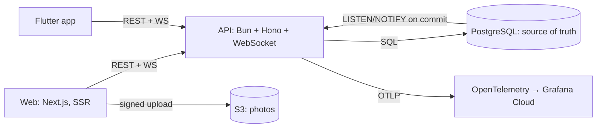

# PLANS: Velio Group Bookings

Part 1 of the assessment: the scope challenges and the three plans (technical, product, tracking), followed by every point where the build changed course.

**Where this comes from.** The thinking here was written before any code, in two longer documents that stay the source of truth:

- [`Velio Group Bookings PRD.md`](Velio%20Group%20Bookings%20PRD.md) holds the product and tracking plans, personas, business rules, risks and decisions.
- [`spec/2026-11-03_07-42_group-bookings-mvp-plan/PLANNING.md`](spec/2026-11-03_07-42_group-bookings-mvp-plan/PLANNING.md) holds the technical plan.

Both were committed on 3 Nov at 08:34 and 10:43 (`git log`); the first application code landed at 16:23 that day. This file condenses them into one document a team can review. Each delivery step after that had its own spec under [`spec/`](spec/), with planning, requirements and validation written before implementation.

**The users, by name.** The plans use four personas throughout:

- **Amara** is a host. She needs a spot count she can trust and to know who is coming.
- **Tunde** is a booker. He wants to bring friends without promising spots that vanish.
- **Zainab** is a friend Tunde vouched for. She opens the link on her phone, often on a weak connection.
- **Kofi** found a public link in a community thread. He has no trust context and plenty of other options.

---

## 1a. Challenging the scope

Five questions for the product owner, each with the assumption I built on. The product owner confirmed all five on 2026-11-03 (PRD decisions D1–D5).

| # | Challenge | Why it matters to users | Assumption I built on |
| --- | --- | --- | --- |
| 1 | **The 25% open-to-claim target blends two different rails.** Vouch and public invites convert very differently, and public links get far more opens. A blended number moves with the mix, not with the product. | We could "hit" 25% by discouraging public sharing, which shrinks Tunde's group and Amara's reach. | Report conversion **per rail**. 25% applies to vouch invites; public links get a week-1 baseline and their own target. The blended rate is shown for context and never triggers anything (D1). |
| 2 | **"Opened" is undefined.** WhatsApp and iMessage fetch link previews automatically, and one person may open a link five times. | Inflated opens would make Zainab's flow look broken when it isn't. | An open is the **first rendered invite page per invite per device**, reported by a beacon after first paint. Preview bots fetch HTML but never run the beacon. |
| 3 | **Invite volume is not the outcome.** 30% of bookers inviting can be reached by nagging, and a claimed spot isn't a person who shows up. Velio's core metric is plans that happen. | Pressure to invite erodes the trust a vouch carries, and ghost claims cost Amara. | Keep 30%, but add guardrails: no-show and removal rates of invited vs. organic attendees, and the share of Plans where everyone attended (host marks attendance). |
| 4 | **Does an invite hold a spot?** If not, Tunde can promise Zainab a spot that sells out before she taps. If it does, unclaimed holds block real bookers. | This is Tunde's main fear and Amara's main cost, in direct tension. | **No holds in MVP.** The invite page shows live spots and a kind sold-out state, and sell-out loss is tracked apart from friction. A short vouch hold ships only if sell-outs exceed 10% of vouch opens (D2). |
| 5 | **What identity does a first-time guest get?** Full auth is out of scope, but attribution needs a stable user. | A sign-up step at the claim moment kills conversion; no identity breaks attribution. | Lightweight identity at claim: display name plus phone or email (stored only as a keyed hash), bound to a session. Generation is stamped once, at creation. |

The PRD also settles three questions the scope ignored:

- **Cancellation** ships with the waitlist, never alone, so a freed spot goes to someone waiting rather than whoever refreshes fastest (D3).
- **A guest who claimed a public link and later receives a vouch** keeps the first claim's attribution forever; the vouch becomes a separate trust edge (D4).
- **Hosts see each attendee's source** ("via Tunde"), but never contacts or private notes (D5).

---

## 1b. Technical plan

Full version: [MVP plan §4](spec/2026-11-03_07-42_group-bookings-mvp-plan/PLANNING.md).

### Principles

1. **The database decides.** Every rule protecting capacity, single-use invites or first-claim attribution is a constraint or a conditional write in Postgres, never an application-side check.
2. **One write path.** Direct bookings and invite claims run through the same booking function in one transaction. No claim path can bypass the spot count.
3. **Realtime is a hint, not the truth.** Clients render pushed counts by version and refetch on reconnect. A lost event can delay a screen; it can never cause an oversell.
4. **Append-only where trust matters.** Invites, claims, attribution and trust edges are insert-only.

### Architecture



### Data model

| Table | Purpose | Key constraint |
| --- | --- | --- |
| `users` | Identity, `contact_hash`, `invite_generation` | Generation set at insert, never updated (trigger) |
| `activities` | Capacity, `spots_left`, `version`, `bookings_paused`, location | `CHECK (spots_left BETWEEN 0 AND capacity)`; date and place lock after the first booking |
| `plans` | One per direct booking; invitees join the inviter's Plan | |
| `bookings` | `source` (direct, vouch, public), `ref`, `idempotency_key`, `status` | Partial unique `(activity_id, user_id) WHERE confirmed`; unique `(user_id, idempotency_key)` |
| `invites` (insert-only) | Code, rail, inviter, Plan, invitee name and contact hash | Unique code; hash chain per activity |
| `invite_opens` | First render per invite per device | Unique `(invite_id, device_id)` |
| `invite_claims` (insert-only) | Which booking claimed which invite | Partial unique on `invite_id` for vouches (single use) |
| `attributions` (insert-only) | Invitee, inviter, invite, rail, generation | Unique `invitee_id` (first claim wins forever); hash chain |
| `trust_edges` (insert-only) | Later vouches for existing users (D4) | |
| `attendance_marks`, `booking_removals` (insert-only) | Host attendance and removals | Latest mark wins |
| `exposures` | Holdout arm per user | Unique `(user_id, flag)` |
| `events` | Product funnel | Written in the same transaction as the fact |

### Concurrency strategy for the last spot

```sql
BEGIN;
-- idempotency: an existing (user, Idempotency-Key) booking is returned unchanged
UPDATE activities SET spots_left = spots_left - 1, version = version + 1
 WHERE id = $1 AND spots_left > 0 AND starts_at > now() AND NOT bookings_paused
RETURNING spots_left, version;        -- 0 rows → read the row to name the reason → ROLLBACK
INSERT INTO bookings …;                -- unique violation → already_booked
INSERT INTO invite_claims …;           -- unique violation → already_claimed (vouch)
INSERT INTO attributions …;            -- new users only; hash-chained
INSERT INTO events …;
SELECT pg_notify('activity_spots', …); -- delivered only if this commits
COMMIT;
```

**Why a conditional `UPDATE`.**

- It's one atomic statement. The row lock it takes serializes everything else for that activity, including the attribution hash chain.
- The `CHECK` constraint is a second line of defence.
- The transaction stays short, and there's no read-then-write window.

**Alternatives rejected:**

- `SELECT … FOR UPDATE` then update: the same lock with an extra round trip.
- `SERIALIZABLE` with retries: retries pile up under the exact contention we expect.
- A Redis counter in front of the database: two sources of truth that can disagree after a crash.
- A per-activity queue: correct, but it adds latency and moving parts before contention is shown to exist. It's kept as R2's fallback.

**Proof.** An automated test fires 200 truly parallel HTTP bookings at activities with 1, 5 and 14 spots, against real Postgres. Exactly N succeed, the rest get `sold_out`, and bookings equal capacity. It runs in CI on every push.

### Realtime: from booking to every open client

1. The booking transaction calls `pg_notify`. Postgres delivers it **only if the transaction commits**, in commit order.
2. Each API instance holds one `LISTEN` connection and republishes to Bun WebSocket topics (`activity:<id>`).
3. Each event carries `{spotsLeft, version, committedAt}`. Clients ignore any version at or below the one they have.
4. **On connect or reconnect:** subscribe first, then fetch the snapshot. While disconnected, poll every 10 s. If the listener drops, every client is told to resync.
5. **Latency:** after painting, a client sends `{type: "rendered", version}`, and the server measures ack − commit on its own clock (no client clock skew, a conservative upper bound).

**Why not Redis pub/sub,** which the brief suggests:

- Publishing after commit leaves a gap where a crash loses the event.
- It's one more service to run.
- `NOTIFY` is tied to the commit and handles thousands of notifying commits a second.

Redis is the documented switch if booking volume outgrows `NOTIFY` or a connection pooler is introduced (the realtime module sits behind an interface).

### Immutable, auditable attribution

- **Two guards on insert-only tables.** The API's database role has no `UPDATE` or `DELETE` grant on them, and a trigger rejects changes for every role, including the owner.
- **Hash chain.** Each `invites` and `attributions` row stores `row_hash = sha256(prev_hash ‖ canonical row)`, chained per activity. A trigger sets these under the activity row lock, whatever the caller sends.
- **Audit.** `audit_chain(activity)` recomputes the chains and reports the first broken row. It runs nightly and on demand from the admin page.
- **Corrections are new rows, never edits.** First claim sets inviter and generation forever (unique `invitee_id`), and later vouches are trust edges.

### Rollout behind a flag with a holdout

- **Flag and assignment.** `group_invites` assigns 10% of users to a holdout by a stable hash of the user ID.
- **Enforcement.** The **server** enforces it: holdout users get `canInvite: false` and `403` on invite creation, so no client can leak the feature.
- **Logging.** The arm is logged at first exposure (the first time someone reaches an invite surface) and never changes.
- **Stages.** Internal → one community (Explore Kenya) → general availability with a 10% holdout → keep, iterate or remove after 4 weeks.

### Risks

Ranked by harm to users. All twelve are in the PRD's risk table.

| Risk | Mitigation built in | Fallback |
| --- | --- | --- |
| R1 Oversell | Conditional decrement, constraints, concurrency test in CI, oversell check every 5 min | Per-activity kill switch |
| R2 Hot-row contention at peak | One short transaction; load test at 10× assumed peak (500 bookers, 5,000 viewers) | Per-activity queue; correctness unchanged |
| R3 Realtime outage leaves counts stale | Versioned events, resync, polling | The database still decides; a stale screen ends in a kind sold-out state |
| R4 Sells out between invite and claim | Live spots on the invite page; sell-out loss tracked separately | Vouch hold (D2), waitlist |
| R7, R10 Spam links, guessed codes | Per-link limits and auto-pause; 10 bad codes per device an hour | Longer codes, longer lockout |
| R11 Attribution edited by hand | Insert-only plus hash chain plus audit | Restore from the verified log |
| R12 Holdout contaminated by public links | Booker-level, intention-to-treat analysis | Report the effect as a lower bound |

---

## 1c. Product plan

Full version: [PRD, User flows and Edge cases](Velio%20Group%20Bookings%20PRD.md#user-flows).

### Flows

**Host (Amara, web)**

1. She switches to Host and creates an activity: title, photo, description, date and time, location (Places search plus a pin), price and spots. She sees a preview card first.
2. She publishes. The activity appears in its community.
3. Live attendance shows each booking as it lands, with its source (direct, "via Tunde", public link), never contacts.
4. She can remove an attendee, which frees the spot on every screen at once. After the start time she marks people attended or no-show.

**Booker (Tunde, web or app)**

1. He opens an activity and sees live spots left, the host, the price ("pay the host on the day") and who's going.
2. "Book a spot" shows progress at once, with the same idempotency key on retry.
3. He lands in his Plan. The invite step comes first: **Invite a friend** (a vouch, with a name and an optional note) or **Share link** (public).
4. Invites go out through his own WhatsApp, SMS or share sheet. Velio sends nothing on his behalf.
5. The Plan shows each invite as created, then opened, then claimed, live.

**Invited guest (Zainab or Kofi, app or mobile web)**

1. She taps the link (it opens the app if installed, otherwise the server-rendered web page) or types the 6-character code.
2. She sees "Tunde wants you on Sunset Kayaking", live spots, and who's going. Nothing promises a held spot.
3. **Claim**: a name and phone or email the first time. Returning devices see "Claiming as Zainab". A haptic confirms "You're in", with the Plan and booking reference.
4. She can invite her own friends (generation 2).

### Edge cases users will hit

Every failure ends with a next step, never a raw error.

| Situation | What they see | Underneath |
| --- | --- | --- |
| Sells out mid-checkout | "Someone just took the last spot. We didn't book or charge you." Then the host's other dates and "More in [community]" | Typed `sold_out`; the optimistic state is rolled back |
| Invite for a full activity | "This one filled up before you got here," plus "Tell Tunde" (a prefilled reply), other dates and the community | The open still counts, so sell-out loss shows separately |
| Vouch already claimed | "This invite has already been claimed." If it was this device, its booking is shown instead | Single use enforced in the booking transaction |
| Expired code | "This invite expired when the activity started," with next steps | Invites expire at the start time |
| Mistyped code | An inline error; the code stays in the field | Rate-limited per device |
| Guest offline | The cached activity, labelled "Last updated 10 min ago". Claim is disabled with "Reconnect to claim" | **Claims are never queued offline**: a queued claim could land after a sell-out |
| Live connection drops | A "Reconnecting" pill; spots grey out until fresh | Snapshot refetch before trusting events |
| Server error | "We couldn't confirm your spot. Nothing was booked." Retry | The same idempotency key, so a slow success never books twice |
| Already booked or started | "You're already going" with a link to the Plan / "This activity has started" | Constraint / start-time check |

### 48 hours vs. next

- **In the build:** everything above on web and Flutter. Also:
  - the concurrency test;
  - the metrics endpoint and admin page with the five goals;
  - SQL views for invite rate, open-to-claim and K-factor by rail;
  - the flag with holdout in code.
- **Next, in order:**
  1. Waitlist and booker cancellation together (D3), with 24 h reminders and a one-tap "can't make it".
  2. A vouch spot hold, only if D2's trigger fires.
  3. Push notifications when a friend claims.
  4. Host payouts once payments are in scope.

---

## 1d. Tracking plan

Full version: [PRD, Success metrics and tracking](Velio%20Group%20Bookings%20PRD.md#success-metrics-and-tracking).

| Goal | Metric | How measured | Target | Trigger for an improvement plan |
| --- | --- | --- | --- | --- |
| Never oversell | Activities with confirmed bookings > capacity | SQL check after every booking and every 5 min (`v_oversell`, gauge `oversell_activities`) | 0 | Any single occurrence pages |
| Bookings succeed | Successes ÷ (successes + server errors) on available spots; typed refusals aren't failures | Server events `booking_succeeded`, `booking_rejected` (with reason), `booking_failed` | ≥ 99.5% | Below 99.5% over any 1 h |
| Availability feels live | p95 commit-to-render | Client render ack vs. server commit time (`realtime_commit_to_ack_seconds`) | ≤ 2 s | p95 > 2 s for 15 min |
| Bookers invite | Bookers creating an invite within 24 h ÷ exposed bookers (holdout excluded), per rail | `v_invite_rate` | 30% | Below 25% for 7 days |
| Invites convert (vouch) | Claims ÷ unique human opens | `v_open_to_claim_by_rail` | 25% | Below 20% for 7 days |
| Invites convert (public) | Same, public rail | Same | Week-1 baseline | 25% below baseline for 7 days |
| Core: K-factor | New users from claims ÷ inviting users, per rail | `v_k_factor_by_rail` (attributions) | Week-1 baseline | Vouch K falls 2 weeks running |
| Guardrail: plans happen | Plans where every member attended ÷ Plans that started; invited vs. organic no-show and removal | `v_plans_happened`, `v_guardrail` | Week-1 baseline | Invited bad-outcome rate > 1.5× organic |

### Events

Each event carries the user, activity, invite, rail, generation, platform and time:

- **Funnel:** `activity_viewed` → `booking_succeeded` → `invite_created` → `invite_opened` → `invite_claimed`.
- **Technical:** `booking_rejected` (reason) and `booking_failed`, plus render acks for latency.

Server events are written in the same transaction as the fact they describe, so the funnel can't drift from the data. Every user is stamped with `invite_generation` at creation.

### Holdout design

Invites run behind the `group_invites` flag. 10% of users, assigned by a stable hash of the user ID, are a holdout who never see invite prompts or tools. The server enforces it, not just the UI. Assignment is logged at first exposure and never changes. After 4 weeks we compare the arms on **new users brought in per booker** and on **Plans that actually happen**. Engaged users both invite more and book more, so only this comparison separates the invite feature's causal effect from that correlation. Public links shared outside Velio can reach holdout users' friends, so the analysis is at the booker level, intention-to-treat, and any contamination makes the measured effect a lower bound.

---

## Changes of course

Each change was decided with the product owner and recorded in a spec change log or a PRD amendment.

| Planned (brief or plan) | Built | Why |
| --- | --- | --- |
| Node.js backend | **Bun + Hono** | Fast setup, a built-in test runner and native WebSocket topics. Hono runs unchanged on Node (`@hono/node-server`), so switching back is cheap. |
| Redis (brief) | **None: Postgres `NOTIFY` for realtime, a Postgres table for rate limits** | `NOTIFY` is delivered only on commit, so no event is published for a booking that rolled back and none is lost between commit and publish. One less service. Redis stays the scale-up path. |
| `docker-compose.yml` at the root with Postgres and Redis | `infra/docker-compose.yml`: Postgres, MinIO (S3), OpenTelemetry Collector, dbmate, k6 | No Redis (above). The infrastructure lives together in `infra/`. |
| `backend/`, `web/`, `mobile/` | `apps/api`, `apps/web`, `apps/mobile`, plus `packages/` (contracts, Dart client, design tokens) | A Bun workspace. One Zod contract generates the OpenAPI document and the Dart client, so the three apps can't drift. |
| A local prototype | Also deployed to AWS (one EC2 instance with Compose behind CloudFront), with Grafana Cloud | Invite deep links and phone checks need a real HTTPS host. Telemetry needed somewhere to land. |
| Flutter for the invited guest only | Guest flow, plus the web's booker and host flows (S7b) | The owner chose app parity (2026-11-04), so mobile users aren't sent to the web. |
| Plain location text | Google Maps: Places search, a pin, a community map with preview cards | Guests need to find the place; communities need a map. A PRD amendment, A4–A7. |
| Store a vouch's raw contact for delivery | Only a keyed hash | Invites go out from the booker's own phone, so Velio never needs the raw contact (PRD Q7). |
| Removed guests can book again | They can't rebook that activity | So a host's removal sticks, for example when a vouch reached the wrong person (PRD amendment). |
| Riverpod in Flutter | `flutter_bloc` (2026-11-05) | The owner's preferred architecture. Behaviour is unchanged, and every bloc has tests. |
| Live kill switch on open pages | Pausing takes effect at once for bookings; open pages show it on their next load or attempt | The realtime protocol had no "refetch activity" event; adding one meant client changes outside S8. |
| Full k6 suite at 10× peak, Playwright E2E, accessibility pass (S9) | **Not done:** the spec is written; only 5% smoke loads ran | Time. See [`NEXT.md`](NEXT.md). |
