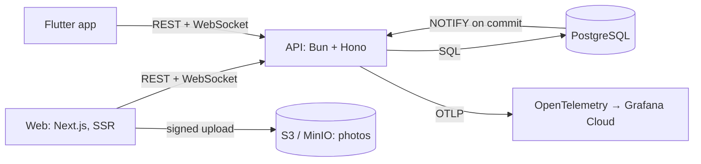

# Velio Group Bookings

Group bookings with live availability and viral invites:

- A **host** lists an activity with a fixed number of spots.
- **Bookers** reserve a spot and bring friends into a shared Plan.
- **Invited guests** claim their spot from a link or code on their phone.

Spots update live on every screen, the system never sells more spots than exist, and every invite records whether it was a **vouch** or a **public share**.

This is the submission for the Senior Fullstack Engineer assessment.

## Submission map

| The brief asks for | Where it is |
| --- | --- |
| `PLANS.md`: scope challenges and the technical, product and tracking plans | [`PLANS.md`](PLANS.md), condensed from the [PRD](Velio%20Group%20Bookings%20PRD.md) and the [MVP plan](spec/2026-11-03_07-42_group-bookings-mvp-plan/PLANNING.md), both written before any code |
| `OWNERSHIP.md`: the improvement plan | [`OWNERSHIP.md`](OWNERSHIP.md) |
| `docker-compose.yml` | [`infra/docker-compose.yml`](infra/docker-compose.yml): Postgres, MinIO (S3), OpenTelemetry Collector. No Redis, by design ([Plan vs. reality](#3-plan-vs-reality)) |
| `backend/` | [`apps/api`](apps/api): Bun + Hono + TypeScript, PostgreSQL |
| `web/` | [`apps/web`](apps/web): Next.js + TypeScript |
| `mobile/` | [`apps/mobile`](apps/mobile): Flutter |
| What I'd do with more time | [`NEXT.md`](NEXT.md) |
| How each piece was planned, built and checked | [`spec/`](spec/): one directory per delivery step, each with `PLANNING.md`, `REQUIREMENTS.md` and `VALIDATION.md` (what was actually run, with results). [`ROADMAP.md`](ROADMAP.md) shows phases and status; [`CHANGELOG.md`](CHANGELOG.md) shows what shipped. |

**How it was built.** Plans came first: the PRD and the MVP plan were committed on 3 Nov at 08:34 and 10:43, and the first code at 16:23. Every delivery step after that (S1–S8) had a spec reviewed before implementation. Each spec's `VALIDATION.md` records the checks that actually ran, including failures and exceptions. The rules for that workflow are in [`CLAUDE.md`](CLAUDE.md).

## 1. Quick start

You need [Bun](https://bun.com) 1.4.4 and Docker. For the mobile app, you also need Flutter 3.47.9 (pinned in `apps/mobile/.fvmrc`).

**Database, storage and API:**

```sh
bun install
docker compose -f infra/docker-compose.yml up -d   # Postgres, MinIO, OpenTelemetry Collector
bun run db:migrate                                 # migrates `velio` and `velio_test`, seeds three communities
bun test                                           # API tests against the real Postgres, including the concurrency test
```

Copy `.env.example` to `.env`, then set two values:

- `CONTACT_PEPPER`: run `openssl rand -base64 48`.
- `ADMIN_TOKEN`: the same command, for the admin page.

Everything else has a working local default. Then start the API and web in two terminals:

```sh
bun run dev        # API on http://localhost:3001 (check: /api/healthz)
bun run web:dev    # web on http://localhost:3000 (proxies /api to :3001)
```

**Cache.** There's no Redis to start. Realtime fan-out uses Postgres `LISTEN/NOTIFY`, and rate limits live in a Postgres table ([why](#3-plan-vs-reality)).

**Mobile:**

```sh
cd apps/mobile
flutter pub get
flutter test                                                                   # unit and widget tests
flutter run --dart-define=API_BASE_URL=http://localhost:3001                   # iOS simulator → local API
flutter run --dart-define=API_BASE_URL=http://10.0.2.2:3001                    # Android emulator → local API
```

**Trying it:**

1. Open the web app and choose "Continue as" (a name and an email; there's no password, by design).
2. Switch to **Host**, create an activity, then book it as a second person in another browser profile.
3. From the Plan, create a vouch invite or a public link, and claim it in the Flutter app with the code.

`bun apps/api/scripts/seed-invites.ts` prints one invite link per invite-page state: claimable, last spot, sold out, claimed and expired.

**Load smoke tests** (with `bun run dev` running):

- `bun run load:smoke`: the k6 last-spot race.
- `bun run load:viewers`: 250 live sockets during a race.

## 2. Architecture and decisions



| Path | What |
| --- | --- |
| `apps/api` | The API: one module per domain (`bookings`, `invites`, `realtime`, `metrics`, …). SQL migrations are in `apps/api/migrations` and are forward-only. |
| `apps/web` | Next.js (App Router, run on Node): host, booker, invite and claim, admin. Server rendering keeps the invite page fast on 3G and gives link previews. |
| `apps/mobile` | Flutter on `flutter_bloc`: code entry, invite and claim, Plan, My plans, offline cache, haptics, App Links. It also has the web's booker and host flows. |
| `packages/contracts` | Zod schemas, the single source of the API contract. They generate `openapi.json`, which generates the Dart client (`packages/api-client-dart`). CI fails on drift, so the three apps can't disagree about a field. |
| `packages/design-tokens` | One `tokens.json` for Tailwind on web and a Dart package in Flutter, so both clients look like one product. |
| `infra/` | Local Compose, production Compose, collector configs, the AWS CDK stack and the Grafana dashboards. |

**Principles:**

- **The database decides.** Capacity, single-use vouches and first-claim attribution are enforced by Postgres constraints and conditional writes, never by an application-side check.
- **One write path.** A claim is a booking, through the same transaction.

### Concurrency: never oversell

[`apps/api/src/modules/bookings/engine.ts`](apps/api/src/modules/bookings/engine.ts) is the only code that writes `spots_left`. A booking runs in one transaction:

1. Take the spot with one conditional `UPDATE activities SET spots_left = spots_left - 1, version = version + 1 WHERE id = $1 AND spots_left > 0 AND starts_at > now() AND NOT bookings_paused`. Zero rows means the API reads the row to name the reason (`sold_out`, `activity_started`, `bookings_paused`) and rolls back.
2. In the same transaction, insert the booking. A partial unique index on `(activity_id, user_id)` turns a double booking into `already_booked`.
3. For a claim, insert the claim (single use for vouches), the attribution and the funnel events.
4. Call `pg_notify` and commit.

A `CHECK (spots_left BETWEEN 0 AND capacity)` is the backstop. Retries carry an `Idempotency-Key` and get the original booking back.

- **Why this over the alternatives.** The update takes the row lock, so everything for that activity is serialized, including the attribution hash chain. The transaction is short, and there's no window between reading and writing.
  - `SELECT … FOR UPDATE`: the same lock with an extra round trip.
  - `SERIALIZABLE` with retries: retries pile up under exactly this contention.
  - A Redis counter: two sources of truth that can disagree after a crash.
- **Proof:** [`apps/api/test/concurrency/last-spot.test.ts`](apps/api/test/concurrency/last-spot.test.ts) and [`claims.test.ts`](apps/api/test/concurrency/claims.test.ts). The first fires 200 truly parallel HTTP bookings, each with its own session, at activities with 1, 5 and 14 spots, against real Postgres. Exactly N succeed, the rest get `sold_out`, and confirmed bookings equal capacity. It also covers same-key retries, host removal and capacity edits racing bookings, and two people claiming one vouch at once. It runs in CI on every push. The k6 `last_spot_race` repeats the race over HTTP.

### Realtime: from booking to every open client

1. The booking transaction calls `pg_notify('activity_spots', {spotsLeft, version, committedAt})`. Postgres delivers it **only if the transaction commits**, in commit order. A rolled-back booking never reaches a screen.
2. Each API process holds one `LISTEN` connection ([`modules/realtime/listener.ts`](apps/api/src/modules/realtime/listener.ts)) and republishes to Bun WebSocket topics: `activity:<id>` for anyone, plus `plan:<id>` and `host:<activityId>` hints for Plans and live attendance.
3. Clients subscribe first, then fetch the snapshot, and ignore any event whose version isn't newer. While disconnected they poll every 10 s. If the listener drops, it reconnects and tells every client to resync, and `/api/readyz` reports unavailable meanwhile.
4. Clients acknowledge each render, and the server measures commit-to-render latency on its own clock. This is the PRD's "feels live" metric. The protocol is in [`packages/contracts/src/realtime.ts`](packages/contracts/src/realtime.ts).

### Attribution that can't be rewritten

- **No edits, enforced twice.** `invites`, `invite_claims`, `attributions`, `trust_edges`, `attendance_marks` and `booking_removals` are insert-only. The API's database role has no `UPDATE` or `DELETE` grant, and a trigger rejects changes for every role, including the owner.
- **Hash chain.** `invites` and `attributions` are hash-chained per activity by a trigger under the activity row lock. `SELECT * FROM audit_chain('<activity>')` finds the first edited or missing row. It runs nightly and from the admin page.
- **First claim wins forever.** A unique `invitee_id` fixes a guest's inviter and generation at their first claim. Later vouches are separate trust edges.
- **Generation is immutable.** `users.invite_generation` (inviter's + 1, organic users are 0) is set at creation and can't change.

## 3. Plan vs. reality

Every deviation was agreed with the product owner and recorded where it happened; the full table is in [`PLANS.md`](PLANS.md#changes-of-course). The main ones:

- **Bun instead of Node.** Faster setup, a built-in test runner and native WebSocket topics. Hono runs unchanged on Node, so switching back is a small change.
- **No Redis.**
  - Postgres `NOTIFY` is delivered only on commit, so no event is published for a booking that rolled back and none is lost between commit and publish. Redis pub/sub publishes after commit, and a crash between the two loses the event.
  - Rate limits sit in a Postgres table.
  - One less service to run.
  - Redis is the documented switch if notifying commits reach the hundreds per second.
- **Layout.** `apps/api`, `apps/web` and `apps/mobile` instead of `backend/`, `web/` and `mobile/`, because shared contracts and tokens live in `packages/`. Compose lives in `infra/`.
- **More than the brief:**
  - the Flutter app has the full booker and host flows, not only the guest flow (owner's call: mobile users shouldn't be sent to the web);
  - Google Maps locations and a community map;
  - a deployment on AWS behind CloudFront, so deep links and real phones could be tested on HTTPS.
- **Privacy tightened.** A vouch's contact is stored only as a keyed hash, never raw, because invites go out from the booker's own phone.
- **Not finished:** the hardening step (S9). Its spec is written; see [Trade-offs](#4-trade-offs).

## 4. Trade-offs

**What I prioritized,** in the PRD's order of risk:

1. Correctness: never oversell, idempotent retries.
2. Live counts.
3. Trustworthy attribution.
4. Then the clients and their states, so no screen is a dead end and sold-out is kind.
5. Then tracking, so every goal in the scope is a number with a target and a trigger.

**Shortcuts, and why they're acceptable for now:**

| Shortcut | Why it's OK for a prototype | Before production |
| --- | --- | --- |
| "Continue as": name plus email or phone, no verification | Full auth is out of scope; guests mustn't hit a sign-up wall at the claim moment | Verified email or phone sign-in |
| One EC2 instance with Postgres in Compose | Lowest cost; same containers move later | Fargate + RDS Multi-AZ |
| CloudFront → origin over HTTP, locked by a secret header and CloudFront's prefix list | No paid domain | CloudFront VPC origin or TLS to the instance |
| Load tested at 5% of the target (25 VUs per activity, 250 sockets), not 10× | The time went to correctness and clients | The S9 full suite from a spot runner (spec written) |
| No browser E2E, no accessibility audit | Component tests cover states (226 web, 293 Flutter); flows were checked by hand on the deployed stack | Playwright with axe in CI; VoiceOver and TalkBack checks |
| iOS opens invites on the web page, not in the app | No Apple Developer account; Android App Links are verified | Universal Links, TestFlight |
| Jobs (oversell check, nightly audit) run in the API process | One instance | A scheduler that survives restarts |

**Taking this to production:** the ranked list is in [`NEXT.md`](NEXT.md). The first steps are real authentication and the encrypted origin hop, then the 10× load run, then the staged rollout from the plan: internal, one community, then general availability with the 10% holdout.

## 5. Where to see the tracking

**The admin page.** Run the app locally, open `/admin` on the web app and enter your `ADMIN_TOKEN`. It shows:

- the five scope goals, each with its target, trigger and whether it has fired;
- the funnel per rail (invites → opens → claims);
- invite rate, K-factor per rail, the plans-happen guardrail and the holdout split;
- a button to run the attribution audit, and the per-activity kill switch.

The same JSON is at `GET /api/admin/metrics?days=7` with `Authorization: Bearer <ADMIN_TOKEN>`.

**SQL views**, one per product goal, in [`apps/api/migrations/20261105090000_metrics_views.sql`](apps/api/migrations/20261105090000_metrics_views.sql). Each row is one fact. To query them:

```sh
docker compose -f infra/docker-compose.yml exec postgres psql -U postgres -d velio
```

```sql
-- Share of exposed bookers who invite within 24 h, by rail (target 30%)
SELECT avg((invited_vouch OR invited_public)::int) AS any_rail,
       avg(invited_vouch::int) AS vouch, avg(invited_public::int) AS public
  FROM v_invite_rate WHERE arm = 'exposed';

-- Open-to-claim per rail (target 25% on vouch)
SELECT rail, sum(claims)::float / nullif(sum(opens), 0) AS open_to_claim
  FROM v_open_to_claim_by_rail GROUP BY rail;

-- K-factor per rail: new users brought in ÷ users who invited
SELECT rail, sum(new_users)::float / nullif(count(DISTINCT inviter_id), 0) AS k_factor
  FROM v_k_factor_by_rail GROUP BY rail;

-- Oversold activities (must be empty), and the plans-happen guardrail
SELECT * FROM v_oversell;
SELECT avg(happened::int) FROM v_plans_happened;
```

**Funnel events.** The server writes `booking_succeeded`, `booking_rejected` (with reason), `booking_failed`, `invite_created`, `invite_opened` and `invite_claimed` to `events`, in the same transaction as the fact itself, so the funnel can't disagree with the data. The web adds `activity_viewed` and Web Vitals. An open is the first *rendered* invite page per device, so link-preview bots don't count.

**Holdout.** [`apps/api/src/modules/flags/`](apps/api/src/modules/flags/) assigns `HOLDOUT_PERCENT` (default 10%) of users to a holdout by a stable hash of the user ID. The arm is logged in `exposures` at first exposure. The API refuses invite tools to the holdout (`canInvite: false`, `403 invites_unavailable`), so no client can leak the feature. `v_holdout` compares the arms on new users per booker and Plans that happen. The design is in [`PLANS.md`](PLANS.md#holdout-design).

**Technical metrics** are exported over OpenTelemetry to Grafana Cloud. No entity IDs are used as labels, and no personal data is exported:

- booking attempts by outcome and booking latency;
- `realtime_commit_to_ack_seconds` (the live-update SLO);
- `oversell_activities` and `audit_chain_failures`.

Three dashboards and four alert rules (oversell, booking success, live p95, broken chain) live as JSON in [`infra/grafana/`](infra/grafana/), with a push script. Locally, the collector prints them: `docker compose -f infra/docker-compose.yml logs -f otel-collector`.

**SLOs: where the prototype stands**, measured, not assumed:

| Goal | Target | Measured |
| --- | --- | --- |
| Never oversell | 0 | 0. The concurrency test passes in CI (200 parallel bookers). The k6 smoke booked exactly 1/5/14 on 1/5/14 spots. The production oversell gauge reads 0. |
| Bookings succeed | ≥ 99.5% | 100% on the deployed stack (31 bookings, 0 server errors) and in the k6 smoke |
| Live updates | p95 ≤ 2 s | 47 ms p95 with 250 sockets during a race (local k6 `viewers`). Not yet measured at 5,000 sockets. |
| Bookers invite / invites convert / K-factor | 30% / 25% vouch | Computed live on the admin page. There's no real user traffic yet, so today's figures come from test use and aren't evidence either way. |

The load figures are smoke-scale (5% of the target). The full 10× run is the first item in [`NEXT.md`](NEXT.md).

---

## Reference

### Scripts

| Command | Does |
| --- | --- |
| `bun run db:migrate` | Applies pending migrations to `velio` and `velio_test` |
| `bun run db:codegen` | Regenerates `apps/api/src/db/types.ts` (`--verify` to check only) |
| `bun run contracts:openapi` · `contracts:dart` | Regenerates `openapi.json` and the Dart client; CI fails on drift |
| `bun test` | API unit and integration tests against the Compose Postgres |
| `bun run typecheck` · `lint` · `format` · `format:check` | TypeScript, ESLint, Prettier |
| `bun run dev` · `web:dev` · `web:build` · `web:test` | API with reload; Next.js dev, build, Vitest |
| `bun run tokens:build` | Regenerates design-token outputs |
| `bun run load:smoke` · `load:viewers` | k6 smoke runs against the local API |
| `bun run grafana:push` | Pushes dashboards and alert rules to Grafana Cloud |
| `bun run aws:synth` · `aws:diff` · `aws:deploy` · `aws:destroy` | CDK for the `VelioApp` stack (each needs `-c alertEmail=…`) |

After changing a migration or a route, run `db:codegen` or `contracts:openapi` (then `contracts:dart`) and commit the result.

### Environment

Every variable is documented in [`.env.example`](.env.example). The API refuses to start, naming the variable, if one is missing or invalid.

- `CONTACT_PEPPER` keys contact hashes; changing it orphans every user.
- `DATABASE_LISTEN_URL` must be a direct connection, never a pooler.
- `HOLDOUT_PERCENT` defaults to 10 (tests use 0).
- `ADMIN_TOKEN` empty means admin answers 404.

### Database

- **Roles:** `velio_owner` owns the schema, `velio_api` is the runtime role, and `velio_readonly` reads the metrics views.
- **Trigger errors** use SQLSTATE class `VL`: `VL001` location locked, `VL002` insert-only, `VL003` immutable column, `VL004` invalid time zone.

### Invites, limits and the kill switch

- **Vouch invites** are single use, addressed to one named person, and store the contact only as a keyed hash.
- **Public links** allow 60 claim attempts a minute. They pause themselves after 200 opens in an hour with under 2% claimed; the creator or host can resume them.
- **Code guessing:** more than 10 unknown codes from one device in an hour locks it out of every code until the hour ends.
- **Kill switch:** the admin page pauses bookings and claims per activity.

### Mobile app

iOS 15+ and Android 8+. The app isn't distributed; run it on a simulator, an emulator or a cabled phone.

- **Maps:** native maps need keys (`apps/mobile/android/secrets.properties`, `apps/mobile/ios/Flutter/Secrets.xcconfig`, both git-ignored) and `--dart-define=MAPS=true`. Without them, the app shows the address and a directions link.
- **Places search:** set `--dart-define=PLACES_KEY=…`.
- **App Links:** they open the app on Android when the web serves `assetlinks.json` for the signing key. iOS uses code entry.
- **Integration tests:** `flutter test integration_test --dart-define=SMOKE_CODE=<code>` books a spot.

Design and checks: [`spec/2026-11-04_12-50_s7-flutter-app/`](spec/2026-11-04_12-50_s7-flutter-app/), [`spec/2026-11-04_23-59_s7b-flutter-web-parity/`](spec/2026-11-04_23-59_s7b-flutter-web-parity/).

### Production (AWS)

One `t4g.small` in eu-west-2 runs Docker Compose (Postgres, API, web, OpenTelemetry Collector) behind CloudFront.

- **Access:** the instance accepts only CloudFront, the API rejects requests without CloudFront's secret header, and there's no SSH (SSM only).
- **Deploys:** every push to `master` that passes CI builds arm64 images, deploys through SSM, migrates, restarts, checks health through CloudFront, and rolls back if the new release never becomes healthy.
- **Backups:** a nightly `pg_dump` to S3, kept 14 days, plus daily EBS snapshots. The restore mechanism was tested on 4 Nov.

The full runbook (first-time setup, quotas, Grafana Cloud, dashboards push, shell access, restore, AMI updates, teardown) is in [`infra/aws/README.md`](infra/aws/README.md); the design and checks are in [`spec/2026-11-03_16-15_s10-aws-app-stack/`](spec/2026-11-03_16-15_s10-aws-app-stack/). First-time deploy:

```sh
export AWS_REGION=eu-west-2
bun run --cwd infra/aws cdk bootstrap aws://$(aws sts get-caller-identity --query Account --output text)/eu-west-2
bun run aws:deploy -c alertEmail=you@example.com
```

Then set the repository variable `AWS_DEPLOY_ROLE_ARN` to the stack's `DeployRoleArn` output, push to `master`, and make the two GHCR packages public.

To roll back, run the Deploy workflow by hand with an earlier SHA.
