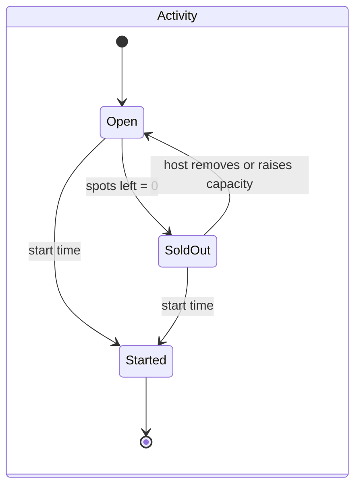
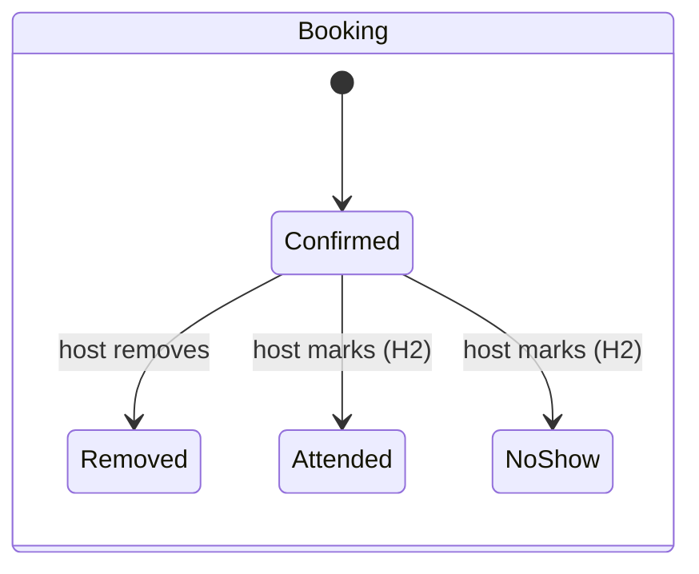
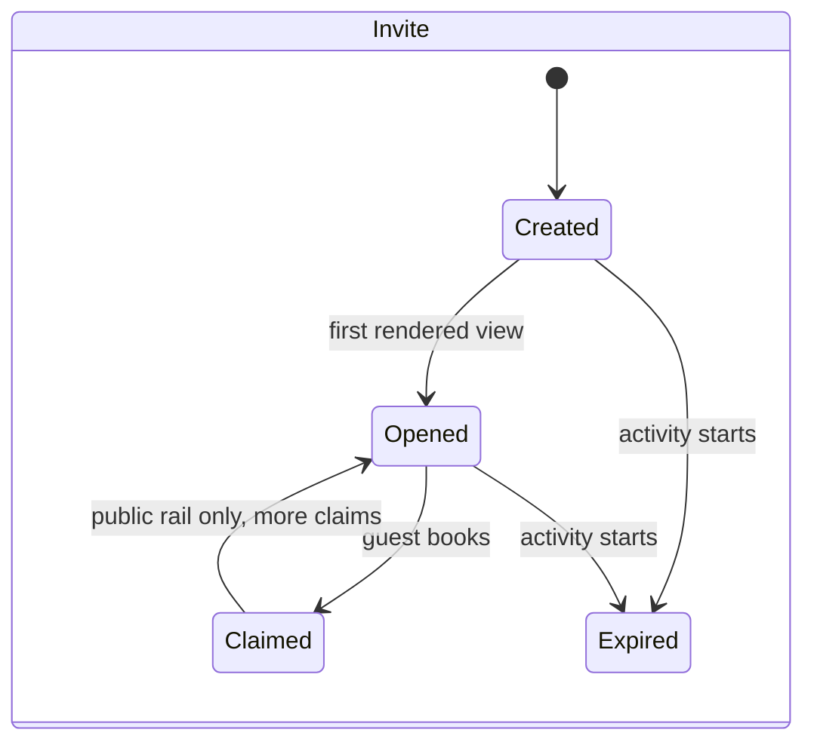

# Velio Group Bookings PRD

Nov 3, 2026 · Owner: @abdulbasit · Status: decisions D1–D5 and Q1–Q12 confirmed

## TL;DR

Group Bookings lets a **host** list an activity with a fixed number of spots, lets **bookers** reserve a spot and bring friends into a shared Plan, and lets **invited guests** claim their spot from a link or code on their phone in one flow. Spots update live on every screen, and the system never sells more spots than exist.

Success means the feature grows Velio's network with people who actually show up. We measure that with five targets: zero oversold bookings, 99.5% booking success on available spots, live updates within 2 seconds at p95, 30% of bookers sending an invite, and 25% of opened invites ending in a claimed spot. Every invite records whether it was a **vouch** (sent to a specific person, carries trust) or a **public share** (reach only), so we can see which kind brings in people who stay.

## Glossary

| Term | Meaning |
| --- | --- |
| **Activity** | A dated experience with a fixed capacity, created by a host. |
| **Spots left** | Capacity minus confirmed bookings. Stored and enforced by the database; never below zero. |
| **Booking** | One person's confirmed spot on one activity. Direct bookings and invite claims are both bookings. |
| **Plan** | The shared group around one activity. Created by a direct booking; joined by claiming an invite from a Plan member. |
| **Invite** | A code and deep link created by a Plan member. Either a vouch or a public share. |
| **Vouch** | A single-use invite addressed to one named person. Carries the inviter's trust. |
| **Public share** | A multi-use link for anyone. Reach only, no trust. |
| **Rail** | Which kind of invite a guest came through: vouch or public. Metrics are reported per rail. |
| **Claim** | Booking a spot through an invite. |
| **Generation** | Distance from organic sign-up. Organic users are generation 0; a new user who claims an invite is the inviter's generation + 1. Fixed at user creation. |
| **Attribution** | The append-only record of who brought whom, through which rail and code. |
| **Open** | The first rendered view of an invite page per invite per device. |
| **Holdout** | The 10% of bookers who never see invite tools, used to measure the causal effect of invites. |

## Context

Group Bookings closes the gap between "we should do this together" and "we're booked". Velio is a social travel app built around destination communities, such as Explore Kenya, The Tanzania Experience and The Medina Collective. People post ideas, vote on activities, see whose trip dates overlap with theirs, and move to checkout. The promise is "Find your people. Then go." ([velio.app](https://velio.app/))

Today that journey breaks at the last step. A group agrees on Sunset Kayaking in a community thread, then someone has to book it, chase friends to pay, and hope the spots are still there. Group Bookings makes the booking itself social:

- The activity shows live spots left, so urgency is real, not manufactured.
- Booking creates a **Plan**, the shared object the group gathers around.
- The booker brings friends in with a vouch or a public link, so each booking can recruit the next.

The feature serves Velio's core metric directly: K-factor (new users each existing user brings in) and plans that actually happen. A plan full of strangers who never show up hurts both, which is why this PRD treats trust and turnout as goals, not just invite volume.

Velio's design language carries through all surfaces: cream background, deep forest ink, lime pill CTAs, Nohemi display headings, Satoshi body text, photo cards with avatar stacks and "spots left" badges.

## User personas

Four people make this feature work, and each wants something different from the same booking. The host wants a full, reliable group. The booker wants their friends there. The vouched friend wants to say yes without friction. The public-link visitor wants proof the group is worth joining. The scope names three user types; we split invited guests in two, because a friend with a personal invite and a stranger from a link behave differently, and the vouch vs. share split in our metrics depends on seeing that.

The names and details below are illustrative composites built from Velio's audience: travellers planning trips through destination communities, with a strong East and West Africa and diaspora presence.

### 1. Amara, the host

**Amara Wanjiru, 31, runs small-group experiences in Nairobi.** She hosts a sunrise coffee-farm walk and a Karura Forest bike ride, 8 to 14 spots each. Today she fills them through Instagram DMs and WhatsApp groups and tracks names in a notes app.

- **Goal:** fill every session with people who turn up, without spending her evenings chasing replies.
- **Jobs:** publish an activity in minutes; see who is coming and how they found it; trust the count on the screen.
- **Why she wants invites:** groups of friends fill the last spots faster than strangers, and people who come with friends rarely no-show.
- **What makes her stop:** one oversold session where a guest arrives to no seat. That is a public embarrassment she pays for in reviews. Also: ghost bookings that block spots, and no idea who is in her group.
- **Moments that matter:** the first booking notification; the session going from "2 spots left" to "Sold out"; the attendee list on the morning of.
- **Design implications:** a live attendance view with names, booking source and the inviter's name (D5); spots-left as the headline number; a hard guarantee that the count never goes negative.

### 2. Tunde, the booker

**Tunde Adeyemi, 28, product designer in London, planning a December trip to Nairobi.** He is active in the Explore Kenya community, saw that five people overlap with his dates, and is usually the friend who books first and rallies everyone else.

- **Goal:** lock in a great experience before it sells out, and get his friends there with him.
- **Jobs:** check spots and price fast; book in one tap; get friends in before the spots go.
- **Why he invites:** the trip is better with his people. He sends **vouch** invites to the two or three friends he wants beside him; he posts a **public link** in the community thread to round out the group and meet fellow travellers. A vouch is social capital: he is putting his name on it.
- **What makes him stop:** promising a friend a spot that is gone by the time they tap the link. Fronting money for others. An invite that feels like spam with his name on it.
- **Moments that matter:** the seconds after booking, when excitement is highest; the notification that a friend claimed.
- **Design implications:** prompt the invite on the confirmation screen, not later; show which friends opened and claimed; tell him honestly when spots are about to run out so he can warn friends.

### 3. Zainab, the vouched friend

**Zainab Okafor, 27, Tunde's friend from university, gets his link in a WhatsApp chat.** She has never used Velio. She opens it on her phone, on the bus, on patchy data.

- **Goal:** say yes to Tunde's plan quickly, without a sign-up wall.
- **Jobs:** see what the activity is, when, how much and who is going; claim her spot; know it is really hers.
- **Why she claims:** her friend asked, and his name is on the invite. Trust is already there; friction is the only thing that can lose her.
- **What makes her stop:** an app-store detour or a long sign-up form; a page that will not load on weak signal; tapping claim and learning the activity sold out with no alternative.
- **Moments that matter:** the first two seconds after opening the link; the tap on Claim; the confirmation she can screenshot and send back to Tunde.
- **Design implications:** Tunde's name and invite lead the screen; one-tap claim with minimal identity; activity details cached for offline; haptic confirmation; a kind sold-out state with a way back to Tunde's plan.

### 4. Kofi, the public-link visitor

**Kofi Mensah, 30, solo traveller from Accra, finds a public link in a community thread.** He does not know the booker. He is curious but cautious about joining strangers.

- **Goal:** decide whether this group and activity are worth his time and money.
- **Jobs:** see who is already going, the host, the price and the spots left; join without commitment anxiety.
- **Why he claims:** the activity looks great, people on his dates are going, and spots are running out.
- **What makes him stop:** no social proof; a group that looks empty or random; any hint the link is spam.
- **Moments that matter:** the avatar stack ("+6 going"); spots-left counting down while he watches.
- **Design implications:** show members and community context, not just the activity; live spots-left; same one-tap claim as Zainab. We expect him to convert below Zainab, and we measure his rail separately.

### Personas at a glance

| Persona | Arrives via | Main fear | Feature must give them | Metric they move |
| --- | --- | --- | --- | --- |
| Amara, host | Host dashboard on web | Overselling; no-shows | A count she can trust, live attendance | Zero oversold; plans that happen |
| Tunde, booker | Activity page, web or app | Promising a friend a spot that's gone | Invite prompt at the moment of booking | 30% of bookers invite |
| Zainab, vouched friend | Personal link on mobile | Friction; dead link | One-tap claim, offline-safe | 25% open-to-claim (vouch rail) |
| Kofi, public visitor | Shared link on mobile | Joining strangers blindly | Social proof, live spots | Open-to-claim (share rail); K-factor |

**What all four share:** the spots-left number has to be true. Amara's reputation, Tunde's promise and Zainab's yes all rest on it.

## Problem and goals

**Problem.** Group activities on Velio are agreed socially but booked alone. Hosts cannot trust spot counts, bookers cannot reliably bring friends, and invited friends hit friction at the exact moment they are most willing to say yes. Velio also cannot tell which invites bring in people who stay.

**Goals and targets** (targets set by the scope):

| Goal | Type | Target | Persona it protects |
| --- | --- | --- | --- |
| Never oversell an activity | Technical | Zero oversold bookings, ever | Amara |
| Bookings succeed when spots exist | Technical | 99.5% of attempts on available spots succeed | Tunde |
| Availability feels live | Technical | p95 of 2 s from a booking to every open client updating | Tunde, Kofi |
| Bookers become inviters | Product | 30% of bookers create an invite | Tunde |
| Invites turn into guests | Product | 25% of opened invites end in a claimed spot | Zainab, Kofi |

**Core Velio metric:** K-factor (new users brought in per existing user), reported separately for vouch and public share, plus the share of Plans that actually happen.

**Non-goals:** payments (prices are shown, not charged), full authentication (a simple identity or role toggle), trust scores and host verification.

## Scope challenges

Five questions for the product owner, each with the assumption we build on. The first and third challenge the goals themselves. Decisions D1 to D5, under Risks and decisions, settle the questions these raise. The product owner confirmed all five working assumptions on 2026-11-03.

| # | Question or concern | Why it matters for users | Working assumption |
| --- | --- | --- | --- |
| 1 | **One 25% target blends two different rails.** Zainab (vouch) and Kofi (public) convert very differently, and public links get far more opens. A blended number moves with the mix, not with the product. | We could "hit" 25% by suppressing public sharing, which hurts reach and Tunde's ability to fill a group. | Report open-to-claim per rail. The 25% target applies to vouch invites; public share gets a baseline in week 1 and its own target after. |
| 2 | **"Opened" is undefined.** WhatsApp and iMessage fetch link previews automatically, and one person may open the same link five times. | Inflated opens make Zainab's flow look broken when it is not. | An open = first **rendered** invite page per invite per device, reported by a client beacon after first paint. Preview bots fetch the HTML but never run the beacon, so they are excluded by construction; user-agent filtering is a backup. Repeat opens are de-duplicated. |
| 3 | **Invite volume is not the outcome.** 30% of bookers inviting can be hit with nagging, and a claimed spot is not a person who shows up. Velio's core metric is plans that happen. | Pressure to invite erodes the trust a vouch carries; ghost claims hurt Amara. | Keep 30% as the target, add guardrails: no-show and host-removal rate of invited vs. organic attendees (H2), and share of Plans where every member attended. Booker cancellation is not in MVP (D3), so it cannot be the guardrail yet. |
| 4 | **Does an invite hold a spot?** If not, Tunde can promise Zainab a spot that sells out before she taps. If yes, unclaimed holds block real bookers. | This is Tunde's main fear and Amara's main cost, in direct tension. | MVP: invites do not hold spots. The invite shows live availability and a clear sold-out state. Next: a short "save a spot" hold for vouches, if data shows sell-outs between invite and claim. |
| 5 | **What identity does a first-time guest get?** Full auth is out of scope, but attribution and invite generation need a stable user. | Asking Zainab to sign up kills conversion; no identity breaks attribution. | Lightweight guest identity at claim: display name plus phone or email, bound to a device token. Generation is stamped once, at creation, and never changes. |

## User flows

Each claimed invite can start the next loop: a guest who claims becomes a Plan member who can invite in turn, one generation further from the original booker.

```mermaid
flowchart 
    H[Host publishes activity] --> B[Booker books a spot]
    B --> P[Plan created]
    P --> I{Invite}
    I -->|Vouch| O[Guest opens link or code]
    I -->|Public share| O
    O --> S{Spots left?}
    S -->|Yes| C[Guest claims spot]
    S -->|No| X[Sold-out state]
    C -->|Generation + 1| P
    style C fill:#000000,stroke:#1f3d2b
```

The highlighted node is the outcome the 25% target measures; the sold-out branch is a loss we track separately from friction.

### Host (Amara), web

1. Switches role to Host and taps **Create activity**.
2. Enters title, photo, description, date and time, location (searched on Google Maps and confirmed with a pin, plus an optional meeting point), price and number of spots. Sees a preview card in Velio's style.
3. Publishes. The activity gets a page and appears in the relevant community.
4. Watches the **live attendance** view: spots left, each booking as it lands, and per attendee whether they booked directly, via a vouch (and from whom) or via a public link.
5. Sees the activity flip to **Sold out** the moment the last spot goes.

### Booker (Tunde), web

1. Opens the activity from a community or a direct link. Sees photo, host, date, price, avatar stack and live spots left.
2. Taps **Book a spot**. The button shows progress instantly (optimistic) while the server confirms.
3. On success, lands in the new **Plan** ("You're going to Sunset Kayaking").
4. The confirmation screen leads with the invite step: **Invite a friend** (vouch: choose a contact, add a name, optional note) or **Share link** (public).
5. Sends the vouch through WhatsApp or SMS, or copies the public link.
6. Sees invite status in the Plan: created, opened, claimed. Velio cannot see whether a link was actually sent through WhatsApp or SMS, so "created" is the first state we can stand behind.

### Vouched friend (Zainab), Flutter app or mobile web

1. Taps Tunde's link, or opens the app and types the 6-character code.
2. Sees "**Tunde** wants you on Sunset Kayaking", the activity card, who is going and live spots left. Wording never promises a held spot, since invites do not hold one (scope challenge 4).
3. Taps **Claim my spot**, enters a display name and phone or email.
4. Feels a haptic tap and sees "You're in" with the Plan and members.
5. Can invite her own friends from the Plan (generation 2).

### Public-link visitor (Kofi), Flutter app or mobile web

1. Taps a link posted in a community thread.
2. Sees the activity card plus social proof: members going, the community it came from, spots left.
3. Same claim flow as Zainab. The invite records the public rail and carries no vouch.

## Functional requirements

P0 ships in the first release; P1 follows once P0 metrics are readable.

| ID | Area | Requirement | Priority | Persona |
| --- | --- | --- | --- | --- |
| A1 | Activities | Host creates an activity with title, description, photo, date and time, location, price and total spots. The location is a place chosen with search and a confirmed map pin, plus an editable venue name and address (amended 2026-11-03, Q13). | P0 | Amara |
| A2 | Activities | Activity page shows spots left, updated live on every open client (web and mobile) without refresh. | P0 | Tunde, Kofi |
| A3 | Activities | Activity shows a clear Sold out state the moment spots reach zero, on every client. | P0 | All |
| A4 | Location | Host picks the location with Google Places search and adjusts a draggable pin, and can add an optional meeting-point note (at most 140 characters). | P0 | Amara |
| A5 | Location | Activity, invite, "You're in" and Plan screens show the location on a map with the address and a one-tap "Get directions". The Flutter app uses an interactive map. | P0 | Tunde, Zainab, Kofi |
| A6 | Location | Community pages offer a map of upcoming activities with spots left, beside the list. | P0 | Tunde, Kofi |
| A7 | Location | Maps never block booking: if a map fails to load, the address and directions link still show. | P0 | All |
| B1 | Booking | Booking a spot either succeeds and decrements spots, or fails with a specific reason (sold out, already booked, error). Never both, never a negative count. | P0 | Amara, Tunde |
| B2 | Booking | A person can hold at most one booking per activity; repeat taps and retries are idempotent. | P0 | Tunde |
| B3 | Booking | Booking creates a Plan for that activity, or adds the person to the booker's Plan when they arrive through an invite. | P0 | Tunde, Zainab |
| L1 | Plans | Plan view lists members, how each joined and invite status (created, opened, claimed). | P0 | Tunde |
| L2 | Plans | **My plans** lists every Plan the person belongs to, split into upcoming and past, each with the activity, date, booking reference and members. On web and in the Flutter app (Q14). | P0 | Tunde, Zainab |
| I1 | Invites | Booker creates a **vouch** invite addressed to one named contact, single use. | P0 | Tunde |
| I2 | Invites | Booker creates a **public share** link, multi use, capped by spots left. | P0 | Tunde |
| I3 | Invites | Every invite has a short code (6 characters, unambiguous alphabet) and a deep link. | P0 | Zainab, Kofi |
| I4 | Attribution | On claim, record inviter, invitee, rail (vouch or public), code and the invitee's generation (inviter's generation + 1; organic users are 0). The first claim sets these forever; a later vouch is a separate trust record (D4). | P0 | Velio |
| I5 | Attribution | Attribution records are append-only. Corrections are new records that reference the original, never edits. | P0 | Velio |
| I6 | Invites | Claiming an invite is a booking: it runs through the same transaction and rules as B1 and B2, and consumes a vouch code in that same transaction. There is no separate claim path that could bypass the spot count. | P0 | Amara, Zainab |
| H1 | Host view | Live attendance list with name, booking time and source (direct, "via Tunde", public link), never contact details (D5). Host can remove an attendee (D3). | P0 | Amara |
| H2 | Host view | After start time, host marks each attendee as attended or no-show. This is the only P0 source for "plans that happen". | P0 | Amara, Velio |
| W1 | Web | Responsive web app with a Host / Booker role toggle covering A, B, L, H and I. | P0 | Amara, Tunde |
| M1 | Mobile | Flutter app: open a link or enter a code, view activity, claim a spot. Links open the app when installed and otherwise the mobile web claim page, with the same one-tap flow and no app-store detour. | P0 | Zainab, Kofi |
| M2 | Mobile | Cache the last viewed activity for offline viewing; queue nothing that could oversell. | P0 | Zainab |
| M3 | Mobile | Haptic feedback on claim success and sold out; native loading skeletons. | P0 | Zainab |
| X1 | Next | Waitlist that auto-fills cancelled spots. | P1 | Tunde, Amara |
| X2 | Next | Vouch spot hold: 1 spot for up to 2 h, at most 2 per booker, shipped only if sell-out loss passes 10% of vouch opens (D2). | P1 | Tunde, Zainab |
| X3 | Next | Booker cancellation, shipped with the waitlist so a freed spot goes to people waiting first (D3). | P1 | Tunde |

## Business rules

These rules settle behavior the requirements above imply but do not state. All were confirmed on 2026-11-03; see Resolved questions.

### Plans and membership

- A direct booking creates a new Plan owned by the booker.
- Claiming an invite adds the guest to the Plan the invite came from. This holds for both rails, and for invites created by any Plan member, so Zainab's generation-2 invite fills Tunde's Plan.
- A person is in at most one Plan per activity, because they hold at most one booking per activity (B2).
- Any Plan member can create invites. There is no cap on vouch invites; public links are rate-limited (Q3).

### Capacity and activities

- Capacity can be raised at any time. It can be lowered only down to the number of confirmed bookings.
- Once an activity has a booking, only its title, description, photo and capacity can change. Date, time and location are locked in MVP, because there are no notifications to tell members about a change (Q2). The location lock covers the pin, place, venue name, address and meeting point (Q13).
- An activity's exact location is public: anyone who can see the activity sees the pin and address. The host is told this when setting it (Q13).
- A host cannot cancel an activity that has bookings in MVP (Q1).
- A host cannot book their own activity.
- An activity is stored with its IANA time zone and currency. Times are shown in the activity's local time, labelled with the zone ("Sat 14 Dec, 06:00 Nairobi time"), so Tunde in London sees the time he will actually be there. Prices are shown in the activity's currency, with no conversion in MVP.
- Bookings and claims close at the activity's start time.

### Payment and booking reference

- Prices are shown as "{price} · pay the host on the day". Velio takes no payment and shows no checkout (Non-goals).
- Every booking gets a short reference such as `VLO-48213`. The guest sees it on the success screen and in the Plan, so they can screenshot it, and the host sees it in the attendance list for check-in.

### Host removal

- A removed attendee's spot is freed immediately and goes to whoever books next. Hosts are told this before confirming. The race D3 avoids for self-serve cancellation is accepted here, because removals are rare and deliberate.
- The removed person sees "The host removed this booking" on the Plan. Their attribution record is unchanged.
- A removed person can't book the same activity again, so the host's removal sticks (for example, when a vouch reached the wrong person). The host's other dates stay open to them (amended 2026-11-03, owner decision in the S2 booking-core spec).

### Identity

- A user can act as host and as booker. The role toggle switches the interface, not permissions. Host actions are allowed only on the user's own activities.
- A guest who already has a Velio identity on the device is recognised at claim and skips the name and contact step.
- An existing user who claims an invite does not count as a new user for K-factor, and keeps their original generation. The claim is still attributed to the inviter for invite-conversion metrics.

### Communities, people and what is public

- Communities are real records: name, slug, cover photo and a short blurb. Explore Kenya, The Tanzania Experience and The Medina Collective are seeded. Each community has a page listing its upcoming activities with spots left. Every activity belongs to one community. There is no posting or voting in MVP.
- "More in [community]" means upcoming activities in the same community that still have spots, soonest first, excluding the current one.
- Avatars are initials on a colour derived from the user's ID. There are no photo uploads for people in MVP.
- **Names by audience:**

  | Who is looking | What they see of other people |
  | --- | --- |
  | Anyone with an invite link, on public surfaces (invite page, activity page, profile, community page) | First name and last initial ("Tunde A.") |
  | Plan members | Each other's full display names |
  | The host | Full display names and sources (D5) |

- **A profile page** shows a display name in the public form above, an initials avatar, "On Velio since [month year]", and upcoming activities the person hosts. It never shows bookings or Plans, because where and when someone will be is a safety concern.

## Lifecycles

A vouch is claimed at most once. A public link stays claimable until the activity starts or sells out. Sold out is not an invite state: the invite page shows it live, and the invite becomes claimable again if a spot frees up.

## Notifications in MVP

There are no push notifications, email or SMS sent by Velio in the first release; push is in Next. Every status change shows up live in the relevant view:

- Tunde sees invites move from created to opened to claimed in the Plan.
- Amara sees bookings land in the attendance view.
- Guests see a "You're in" screen they can screenshot.

Invite delivery uses the booker's own share sheet (WhatsApp, SMS, copy link). This keeps the vouch personal and means Velio sends nothing on the booker's behalf.

## Operations and admin

- **Kill switch per activity:** stops new bookings and claims, for R1's fallback.
- **Public-link pause:** by the host, by the link's creator, or automatically under R7.
- **Oversell check:** runs after every booking and every 5 minutes, and pages on any hit.
- **Admin metrics page:** the five goals, funnel per rail, K-factor and the guardrail, with the holdout split.
- **Attribution audit:** verifies the hash chain on demand and nightly.

## Edge cases and UX states

Every failure ends with a next step, never a dead end or a raw error.

| Situation | Who hits it | What they see | What happens underneath |
| --- | --- | --- | --- |
| Spot sells out mid-checkout | Tunde | Button reverts gently: "Someone just took the last spot. We didn't book or charge you." Options: the host's other dates, "More in [community]". (Join the waitlist arrives with P1.) | Optimistic state rolled back; server returned a typed `sold_out`; sold-out rejection metric incremented. |
| Invite opened for a full activity | Zainab, Kofi | "This one filled up before you got here." Shows who is going, plus three next steps: "Tell [inviter]" opens the share sheet with a prefilled reply, the host's other dates, and "More in [community]". | Open is still recorded so the funnel shows sell-out loss separately from friction loss. |
| Vouch code already used | Zainab | "This invite has already been claimed." If it was claimed by her own device, show her booking instead. | Single-use enforced in the same transaction as the booking. |
| Expired code | Zainab, Kofi | "This invite expired when the activity started." Links to the inviter's profile page, the host's other dates and "More in [community]". | Invites expire at activity start time. |
| Invalid or mistyped code | Zainab | Inline field error, code stays in the field to fix; no screen change. | Rate-limited per device to stop code guessing. |
| Guest is offline | Zainab | Cached activity card with a "Last updated 10 min ago" label; Claim disabled with "Reconnect to claim". | Claims are never queued offline, because a queued claim could succeed after the activity sells out and confuse everyone. |
| Already booked | Tunde | "You're already going" with a link to the Plan. | Unique constraint on (activity, user). |
| Live connection drops | All | Small "Reconnecting" pill; spots-left greys out until fresh. | Client re-fetches the snapshot on reconnect before trusting events. |
| Server error on booking | Tunde | "We couldn't confirm your spot. Nothing was booked." Retry button. | Retry uses the same idempotency key, so a slow success is never booked twice. |
| Activity already started | Anyone with a link | "This activity has started." Shows the host's other activities. | Bookings and claims are rejected after start time. |
| Guest claims a vouch meant for someone else | Wrong recipient | Claim succeeds: the code is the credential in MVP. The Plan shows the name the guest entered, so Tunde can spot it and ask Amara to remove them. | No contact verification in MVP (non-goal). A contact-hash mismatch is logged for review. |
| Host removed the booking | Removed guest | Plan shows "The host removed this booking," with the host's other dates. | Spot freed in the same transaction; attribution untouched. |

## Non-functional requirements

- **Correctness under concurrency.** The spot count is enforced by the database, not the app: a conditional decrement (`UPDATE activities SET spots_left = spots_left - 1 WHERE id = $1 AND spots_left > 0`) inside the booking transaction, plus a unique constraint on (activity, user). An automated test fires truly parallel requests at the last spots and asserts exactly N succeed, the rest get `sold_out`, and bookings equal capacity.
- **Live availability.** The booking transaction emits a Postgres `NOTIFY` with the new count, which Postgres delivers only if the transaction commits. Every API instance listens and fans it out over WebSockets to clients viewing that activity. (Decided 2026-11-03 over Redis pub/sub, which has a gap between commit and publish and needs another service. Redis remains the path if booking volume outgrows `NOTIFY`.) Each event carries a monotonically increasing version, so clients ignore stale or out-of-order updates. Target: p95 ≤ 2 s from commit to client render, measured by client acknowledgements.
- **Immutable attribution.** Invites and attribution events live in append-only tables. The database role used by the API has no UPDATE or DELETE on them, and a trigger rejects changes. Each row stores a hash of the previous row for the activity, so tampering is detectable in an audit.
- **Performance.** Activity page first content under 1.5 s on a mid-range Android over 3G, since Zainab and Kofi mostly arrive on mobile.
- **Privacy.** A vouch stores the invitee's contact only to deliver and match the invite. Hosts see names, not phone numbers or emails. Contact details never appear in URLs. Maps are provided by Google, and the privacy note says that loading a map shares the viewer's IP address with Google.
- **Accessibility.** WCAG AA contrast on Velio's cream and forest palette; spots-left changes are announced to screen readers politely, not on every tick.

## Success metrics and tracking

Every scope goal has a metric, a measurement and a trigger that makes us write an improvement plan.

| Goal | Metric | How measured | Target | Trigger |
| --- | --- | --- | --- | --- |
| Never oversell | Activities where bookings exceed capacity | SQL check on bookings vs. capacity, run every 5 min and on every booking | 0 | Any single occurrence pages on-call |
| Bookings succeed | Successes ÷ attempts where spots were available at attempt time | Server counters: `booking_attempt`, `booking_success`, `booking_sold_out`, `booking_error` | ≥ 99.5% | Below 99.5% over any 1 h window |
| Availability feels live | p95 commit-to-render latency | Event carries server commit time; client acks with render time | ≤ 2 s | p95 > 2 s for 15 min |
| Bookers invite | Bookers who create ≥ 1 invite within 24 h ÷ bookers exposed to the feature (holdout excluded) | Product events, per rail | 30% | Below 25% for 7 days |
| Invites convert (vouch) | Claims ÷ unique human opens, vouch rail | Product events | 25% | Below 20% for 7 days |
| Invites convert (public) | Claims ÷ unique human opens, public rail | Product events | Week-1 baseline, target set after (D1) | Falls 25% below baseline for 7 days |
| Core: K-factor | New users from claimed invites ÷ inviting users, per rail | Attribution table | Baseline in week 1 | Vouch K-factor falls 2 weeks running |
| Guardrail: plans happen | Plans where every member was marked attended ÷ Plans that reached start time | Host attendance marks (H2) | Baseline in week 1 | Invited no-show or removal rate > 1.5× organic |

**Funnel events** (each with user id, activity id, invite id, rail, generation, platform, timestamp): `activity_viewed` → `booking_succeeded` → `invite_created` → `invite_opened` → `invite_claimed`. Plus `booking_attempted`, `booking_rejected` (with reason) and `availability_rendered` for the technical goals. Every user is stamped with `invite_generation` at creation.

**Holdout design.** Invites run behind a feature flag. 10% of bookers (including guests who claimed through an invite), assigned by a stable hash of user id, are a holdout who never see the invite prompt or invite tools; the remaining 90% get the feature. Assignment is logged at first exposure and never changes. After 4 weeks we compare the two arms on new users brought in per booker and on Plans that actually happen. The difference is the causal effect of invites, separate from the fact that engaged users both invite more and book more. Public links shared outside Velio can leak to holdout users' friends, so we measure at the booker level, not the guest level.

## Release plan

The 48-hour prototype proves the riskiest parts: no overselling, live counts and trustworthy attribution. Polish and growth levers come after.

**In the 48-hour build:** all P0 requirements above; the concurrency test; a metrics endpoint and admin page showing the five goals; SQL views for invite rate, open-to-claim and K-factor by rail; the feature flag with holdout assignment in code.

**Next, in order:** waitlist and booker cancellation together (X1, X3; D3), with 24 h reminders and a one-tap "can't make it" that uses the same cancellation path (R8); vouch spot hold (X2), only if sell-out loss passes 10% of vouch opens (D2); push notifications when a friend claims; host payouts once payments are in scope.

**Rollout behind the `group_invites` flag:**

1. **Internal:** Velio team and a handful of friendly hosts. Exit when the oversell check has run clean and live-update p95 is within target.
2. **One community:** Explore Kenya, where plan overlap is already high. Exit when funnel events reconcile with database counts within 1%.
3. **General availability with holdout:** all communities, 90% exposed, 10% holdout. Read the causal result after 4 weeks.
4. **Decide:** keep if the exposed arm brings in more new users per booker than the holdout and no guardrail has triggered; iterate if the lift is positive but a guardrail fired; remove if there is no lift.

## Risks and decisions

Risks are ranked by harm to users, worst first. Each one has a signal that warns us early, a mitigation built in from the start, and a fallback if it happens anyway.

### Risks

| # | Risk | Who it hurts | Early signal | Mitigation (built in) | Fallback if it happens |
| --- | --- | --- | --- | --- | --- |
| R1 | Concurrency bug oversells an activity | Amara, Tunde | Oversell check > 0 | Conditional decrement in the booking transaction; unique (activity, user) constraint; concurrent last-spot test runs in CI on every change | Kill switch pauses booking for that activity; host alerted; displaced guest gets priority on the host's next date |
| R2 | Hot activity: row contention slows bookings at peak | Tunde | Booking latency p95; lock wait time | Single short transaction on one row; load test at 10× expected peak (Q4: 500 bookers on one activity within 10 s, 5,000 concurrent viewers) | Per-activity booking queue (Redis stream, one worker); correctness unchanged |
| R3 | Realtime listener or WebSocket outage leaves spot counts stale | Tunde, Kofi | `availability_rendered` p95; drop in open sockets | Versioned events; snapshot re-fetch on reconnect; clients poll every 10 s while the socket is down | Bookings still correct because the database decides; a stale screen ends in the kind sold-out state, never an oversell |
| R4 | Activity sells out between invite and claim | Zainab, Tunde | Share of invite opens landing on sold out | Live spots on the invite page; sell-out loss tracked apart from friction loss | Vouch hold (D2) and waitlist (D3) |
| R5 | Duplicate guest identities (one person, two devices) | Velio metrics | Same contact hash on several users | Match on a normalised phone or email hash at claim; first identity wins | Merges stored as append-only links; original attribution never rewritten |
| R6 | Invite prompt feels pushy | Tunde, Zainab | Prompt dismiss rate; invited vs. organic cancellations | One prompt at confirmation, easy to dismiss, never repeated | Test a quieter prompt against the current one, both measured against the holdout |
| R7 | Public links spread to spam channels | Amara, Kofi | Opens per link spike while claims stay under 2% | Links capped by spots left; per-link rate limits; host can switch public links off | Auto-pause a link that crosses the threshold and notify its owner |
| R8 | No-shows from easy claims | Amara | No-show marks (H2) and host removals, invited vs. organic | Attendance marking and host removal in MVP; no-show rate tracked per rail from day one | 24 h reminders with one-tap "can't make it", shipped with cancellation (D3); ask vouched guests to reconfirm; review whether public claims need a deposit when payments arrive |
| R9 | Link-preview bots and repeat opens inflate the funnel | Velio metrics | Page fetches far above rendered opens for a link | Opens counted only from a client render beacon, de-duplicated per invite and device; bot user agents filtered as a backup | Add a short dwell-time threshold before an open counts |
| R10 | Invite codes guessed | Zainab, Amara | Invalid-code attempts per device | 6 characters from a 31-character alphabet (about 887 million codes); 10 attempts per device per hour; vouch codes single use | Lengthen codes and lock the device out for 24 h |
| R11 | Attribution changed by hand | Velio metrics | Hash chain fails verification | Append-only tables; no UPDATE or DELETE grants; corrections as new rows | Restore from the hash-verified log and flag the affected period in reports |
| R12 | Holdout contaminated by public links | Velio metrics | Holdout users appearing as claimers | Assignment and analysis at the booker level, intention-to-treat | Report the effect as a lower bound and note it in the readout |

### Decisions on open questions

The product owner confirmed all five decisions on 2026-11-03. Every decision has a condition that would reopen it.

| # | Question | Decision | Why, in user terms | Reopen if |
| --- | --- | --- | --- | --- |
| D1 | Should the 25% open-to-claim target be per rail? | **Yes.** 25% applies to vouch invites. Public share gets its own target, set from its week-1 baseline. The blended rate is reported for context only and never used as a trigger. | Zainab and Kofi are different people with different reasons to say yes. One blended number would reward Tunde for sharing less, which shrinks his group and Amara's reach. | Vouch volume is under 20% of opens, so the vouch target covers too little traffic to steer by. |
| D2 | Should a vouch invite hold a spot, and for how long? | **Not in MVP.** In P1, a vouch may hold 1 spot for 2 hours, or until 1 hour before start if sooner. Maximum 2 open holds per booker. Holds decrement spots left in the same transaction as bookings, so they can never oversell. Public links never hold. | Holds protect Tunde's promise to Zainab. The 2-hour cap and per-booker limit protect Amara from spots blocked by people who never claim. | Ship the hold only if more than 10% of vouch opens fail because the activity sold out between invite and claim. |
| D3 | Is cancellation in this release? | **No. It ships with the waitlist (P1), as one change.** In MVP, the host can remove an attendee manually. | A freed spot should go first to someone already waiting, not to whoever refreshes fastest. Shipping cancellation alone would create a race that Tunde's friends lose. | Hosts remove more than 5% of bookings by hand, which shows bookers need self-serve cancellation sooner. |
| D4 | A guest claims through a public link, then gets a vouch. Which sets generation? | **The first claim sets generation and inviter forever.** The later vouch is stored as its own append-only trust edge ("Tunde vouches for Kofi"). It counts toward Tunde's vouch activity but not toward K-factor. | Attribution stays immutable and auditable, and Velio keeps the trust signal. Tunde's vouch still means something to Kofi. | Product wants vouches to drive a trust score. That is out of scope now and would need its own model. |
| D5 | Can hosts see who vouched for whom? | **Partly.** Amara sees each attendee's source and the inviter's display name ("via Tunde", "via public link"). She never sees contact details or personal notes on invites. Guests are told this at claim. | Amara needs to see groups to plan seating, boats or tables. The note Tunde wrote to Zainab is between friends. | Guests drop at the claim screen after the disclosure appears; test showing source without the inviter's name. |

## Resolved questions

Raised while writing the business rules and resolved by the product owner on 2026-11-03.

| # | Question | Decision | Reopen if |
| --- | --- | --- | --- |
| Q1 | Can a host cancel an entire activity that has bookings? | **Not in MVP.** A host can remove attendees one by one. Activity cancellation ships with notifications, so members are told. | Hosts ask for it, or remove every attendee by hand. |
| Q2 | Can a host edit an activity after bookings exist? | **Title, description, photo and capacity only**, with capacity no lower than confirmed bookings. Date, time and location are locked. | Notifications ship, so members can be told of a change. |
| Q3 | Is there a limit on invites per booker? | **No cap on vouch invites.** Public links are rate-limited (R7). | The dismiss or spam signals in R6 or R7 fire. |
| Q4 | What traffic should the prototype handle? | **Assumed expected peak:** 50 people booking one activity within 10 s, and 500 concurrent viewers. Load-tested at 10×: 500 bookers and 5,000 viewers. | Real traffic data exists. |
| Q5 | Where do activity photos live? | **S3**, uploaded by the host through a signed URL. One photo per activity. | — |
| Q6 | Standalone prototype, or built into Velio's product? | **Standalone**, with Velio's design language and seeded placeholder communities. Integration is a later step. | Velio's APIs and auth become available. |
| Q7 | How long is a vouch invitee's contact kept? | **Until the activity ends plus 30 days.** After that the salted hash is kept and the raw contact deleted. | Legal or privacy review says otherwise. |
| Q8 | What do avatars show, with no user photos? | **Initials** on a colour derived from the user's ID. | Users ask for photos. |
| Q9 | The sold-out and expired screens offered messaging, following and "similar", none of which exist. What do they offer instead? | **"Tell [inviter]"** through the share sheet, **the host's other dates**, and **"More in [community]"**. Following is dropped. | A messaging or follow feature is scoped. |
| Q10 | Do people have profiles? | **A minimal profile page:** public-form name, avatar, "On Velio since", and upcoming activities they host. Never bookings or Plans. | — |
| Q11 | How real are communities? | **Seeded records with a page** listing upcoming activities. No posting or voting. | Integration with Velio's real communities (Q6). |
| Q12 | What do public visitors see of members? | **First name and last initial.** Full names only inside the Plan and to the host. | Public-rail conversion suffers measurably from the reduced social proof. |
| Q13 | How are locations shown? (Raised 2026-11-03.) | **Google Maps:** host picker with search and pin, a map with directions on activity, invite, "You're in" and Plan screens, a community map, and an optional meeting point (A4–A7). The exact location is public. Flutter uses an interactive map. Spending above Google's free caps is allowed, with a $10 monthly alert. See `spec/2026-11-03_10-34_google-maps-locations/`. | Hosts list activities at private homes, or Maps costs pass the alert regularly. |
| Q14 | How does someone find their Plans again? (Raised 2026-11-03.) | **A My plans screen** (L2) on web and Flutter, tied to the "continue as" identity. On a new device, a person sees their Plans after continuing with the same email or phone. | Real authentication ships. |
