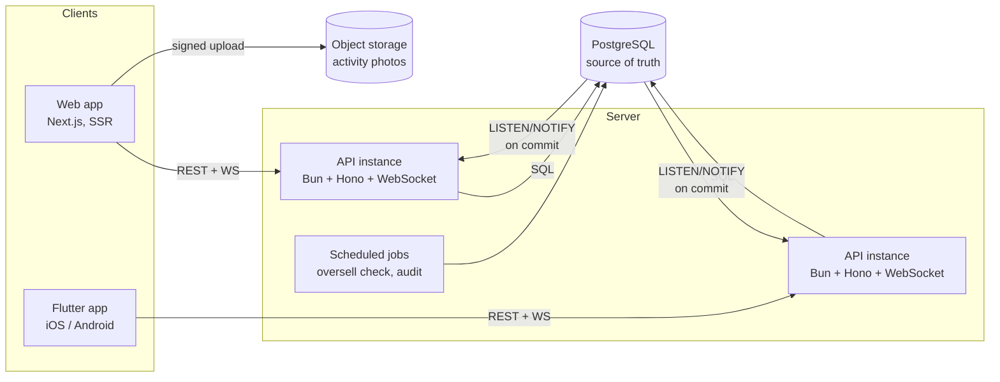
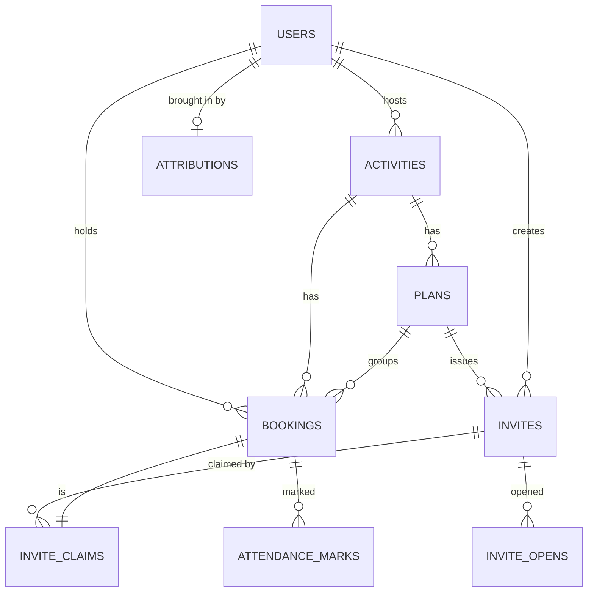
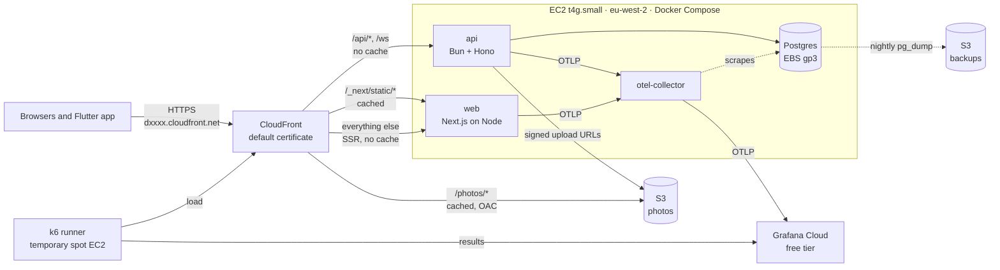

# Planning: Group Bookings MVP: system design, tech stack and project structure

- **Spec ID:** 2026-11-03_07-42_group-bookings-mvp-plan
- **Created:** 2026-11-03 07:42 (local)
- **Status:** Approved (2026-11-03). Implementation authorized only per delivery spec.
- **Source:** `Velio Group Bookings PRD.md` (all section and requirement IDs below refer to it)

This is an umbrella plan. It fixes the architecture, stack and repo layout, and splits the MVP into delivery specs (S1–S9). Each delivery spec gets its own directory and authorization before any code is written.

Claims are tagged **[Verified]** (checked in the PRD or repository), **[Assumption]** or **[Proposal]**.

---

## 1. Problem statement

Build the PRD's 48-hour prototype: activities with live spots-left, overselling made impossible, bookings that create Plans, vouch and public invites with immutable attribution, a host attendance view, a web app and a Flutter claim app, plus metrics and a holdout.

## 2. Context and current behavior

- [Verified] The repository contains only documentation: the PRD, `CLAUDE.md`, `ROADMAP.md`, `CHANGELOG.md` and the constitution spec. There is no code and no git.
- [Verified] The PRD fixes Flutter for mobile, a SQL database with Postgres-style queries, and WebSockets.
- [Verified] Everything else was decided with the user on 2026-11-03 and recorded in §10: Bun + Hono, Next.js, Postgres `NOTIFY`, AWS, S3 photos.
- [Verified] This is a standalone prototype, not built inside Velio's production systems (PRD Q6, confirmed).

## 3. Desired outcome

A plan the user approves, from which delivery specs S1–S9 can be written and implemented in order. Correctness (R1) is proven first, polish last.

---

## 4. System design

### 4.1 Architecture overview



**Principles:**

1. **The database decides.** Every rule that protects capacity, single-use invites or first-claim attribution is a constraint or a conditional write in Postgres, never an application-side check.
2. **One write path.** Direct bookings and invite claims go through a single booking function in one transaction (PRD I6).
3. **Realtime is a hint, not a source of truth.** Clients render pushed counts by version and re-fetch snapshots on reconnect. A lost event can delay the screen; it can never cause an oversell.
4. **Append-only where trust matters.** Invites, claims, attribution and trust edges are insert-only.

### 4.2 Realtime fan-out: Postgres `NOTIFY` ✅ decided 2026-11-03

The booking transaction calls `pg_notify`. Postgres delivers the notification only if the transaction commits, and in commit order. Each API instance holds one dedicated listening connection and republishes to its Bun WebSocket topics (§4.5). The PRD's live-availability NFR was updated to match.

| | Postgres `NOTIFY` (chosen) | Redis pub/sub (rejected for now) |
| --- | --- | --- |
| Event tied to the commit | Yes: sent only on commit | No: publish after commit, so a crash in between drops the event |
| Extra infrastructure | None | ElastiCache |
| Ceiling | A global lock at commit for notifying transactions limits it at thousands of notifying commits per second; payload ≤ 8 kB | Higher |
| Rate limiting | Postgres table | Natural fit |

Neither is durable; both rely on versioned events, a snapshot on reconnect and polling while disconnected (R3).

**Constraints this brings:**
- The listening connection must be direct to Postgres, never through RDS Proxy or a transaction-mode pooler.
- Rate limits live in Postgres.

**Switch to Redis** (an adapter behind the realtime interface) if notifying commits reach the hundreds per second sustained, a connection pooler is introduced, or Redis is adopted for another reason.

### 4.3 Domain model



**Tables** [Proposal]. Insert-only tables are marked (AO).

| Table | Key columns | Key constraints |
| --- | --- | --- |
| `users` | id, display_name, contact_hash, invite_generation, created_at | generation set at insert, never updated (trigger) |
| `sessions` | token_hash, user_id, device_id, created_at | |
| `communities` | id, slug, name, blurb, cover_photo_key | unique `slug`; seeded |
| `activities` | id, host_id, community_id, title, description, photo_key, starts_at, timezone, location, price_minor, currency, capacity, spots_left, version, bookings_paused | `CHECK (spots_left >= 0 AND spots_left <= capacity)` |
| `plans` | id, activity_id, owner_id | |
| `bookings` | id, ref, activity_id, user_id, plan_id, source (direct/vouch/public), invite_id, idempotency_key, status (confirmed/removed), created_at | partial unique `(activity_id, user_id) WHERE status='confirmed'`; unique `(user_id, idempotency_key)`; unique `ref` (`VLO-` + 5 characters from the invite-code alphabet, generated in the booking transaction, retried on collision) |
| `invites` (AO) | id, code, rail, activity_id, plan_id, inviter_id, invitee_name, invitee_contact_hash, note, expires_at, prev_hash, row_hash | unique `code` |
| `invite_controls` | invite_id, paused, paused_by, updated_at | mutable operational state, kept out of the AO table |
| `invite_opens` | invite_id, device_id, first_rendered_at | unique `(invite_id, device_id)` |
| `invite_claims` (AO) | invite_id, booking_id, rail, claimed_at | partial unique `(invite_id) WHERE rail='vouch'` (single use) |
| `attributions` (AO) | invitee_id, inviter_id, invite_id, rail, generation, prev_hash, row_hash | unique `invitee_id` (first claim wins forever, D4) |
| `trust_edges` (AO) | voucher_id, vouchee_id, invite_id, created_at | (D4) |
| `attendance_marks` (AO) | booking_id, mark (attended/no_show), marked_by, created_at | latest mark wins |
| `booking_removals` (AO) | booking_id, removed_by, created_at | |
| `exposures` | user_id, flag, arm, first_exposed_at | unique `(user_id, flag)` |
| `events` | name, user_id, activity_id, invite_id, rail, generation, platform, props, at | analytics funnel (PRD Success metrics) |

**Append-only enforcement** (PRD NFR): the API's database role gets `INSERT, SELECT` only on (AO) tables, and a `BEFORE UPDATE OR DELETE` trigger raises an error as a second guard.

**Hash chain**: `row_hash = sha256(prev_hash || canonical_row)`, chained per activity. The chain is safe under concurrency because every write to it happens while the activity row is locked (§4.4), so writes for one activity are serialized.

### 4.4 The booking transaction

Used by direct bookings and claims alike.

```sql
BEGIN;
-- 0. Idempotency: a booking with (user_id, idempotency_key) already exists → return it unchanged.
-- 1. New guest from an invite: INSERT users (generation = inviter.generation + 1).
--    Rolled back with everything else if the claim fails, so failed claims create no users.
-- 2. Take the spot. This also locks the activity row, serializing everything below per activity.
UPDATE activities
   SET spots_left = spots_left - 1, version = version + 1
 WHERE id = $activity
   AND spots_left > 0
   AND starts_at > now()
   AND NOT bookings_paused
RETURNING spots_left, version;
--    0 rows → read the row to name the reason: sold_out | started | paused → ROLLBACK
-- 3. INSERT bookings          → unique violation  ⇒ already_booked   → ROLLBACK
-- 4. INSERT invite_claims     → unique violation  ⇒ already_claimed  → ROLLBACK
-- 5. INSERT attributions (+ hash), only for users created in step 1
-- 6. INSERT events (booking_succeeded / invite_claimed)
-- 7. SELECT pg_notify('activity_spots', json {activity, spots_left, version, committed_at})
COMMIT;
```

- Read checks for invite validity (exists, not expired, not paused, rail) run before step 2 for clear errors. The constraints above are the authority.
- Typed errors: `sold_out`, `already_booked`, `already_claimed`, `invite_expired`, `invite_paused`, `activity_started`, `bookings_paused`, `invalid_code`, `rate_limited`.
- **Host removal** runs the same shape in reverse: lock the row, `spots_left + 1`, `version + 1`, set status to `removed`, insert into `booking_removals`, notify.
- **Capacity change** runs `UPDATE … SET capacity = $n, spots_left = spots_left + ($n - capacity) WHERE capacity - spots_left <= $n`.

### 4.5 Realtime protocol

- Clients connect over WebSocket and subscribe to activity IDs.
- Within one API instance, each activity maps to a Bun WebSocket pub/sub topic (`activity:<id>`), so a single `server.publish` reaches every subscribed socket. Topics are per process. Fan-out across instances still comes from the database notification bridge (§4.2): every instance listens and republishes to its own topics.
- Server events have the form `{type:"spots", activityId, spotsLeft, version, committedAt}`. A client ignores any version ≤ the one it has (PRD NFR).
- **On (re)connect:** the client fetches `GET /activities/:id` (which includes the version), then applies events. While disconnected it polls every 10 s (R3).
- **Measuring latency** (goal: p95 ≤ 2 s): after rendering, the client sends `{type:"rendered", activityId, version}`, and the server computes `ack_received_at − committed_at` on its own clock. This avoids client clock skew. It slightly overstates latency (it includes the return trip), so it is a conservative upper bound.
- Bookers on the host's attendance view and on Plans also get `{type:"plan"}` and `{type:"attendance"}` events through the same channel.

### 4.6 Identity and sessions (lightweight, per PRD non-goals)

- **Hosts and bookers** "continue as": display name plus email, which issues an opaque session token. The token is stored as an httpOnly cookie on web and in secure storage on mobile. There is no password or verification. **[Assumption] Prototype only**: anyone can claim any email. This is flagged as SEC-008.
- **Guests:** the same session is issued inside the claim transaction. A returning device is recognised by its session.
- **Contact** is normalised (E.164 phone, lowercased email) and stored as a salted hash for matching (R5). The raw value is kept only on vouch invites, for delivery and matching, and deleted after the retention window (PRD Q7).

### 4.7 Invites, links and opens

- **Codes:** 6 characters from the 31-character alphabet `23456789ABCDEFGHJKMNPQRSTUVWXYZ`, generated randomly and retried on collision.
- **Link:** `https://<distribution>.cloudfront.net/i/<code>`, the free CloudFront hostname (§4.11; no paid domain). If a real domain is added later, links already shared keep working only while the old distribution stays live. The web app serves:
  - Universal Links (`apple-app-site-association`) and App Links (`assetlinks.json`), so the Flutter app opens when installed;
  - an SSR claim page otherwise (PRD M1).
- **Link previews:** the SSR page includes Open Graph tags (activity photo, "Tunde wants you on Sunset Kayaking"). Bots get the preview and never run the open beacon.
- **Open:** the client posts `POST /invites/:code/opens` after first paint with a device ID. Inserting into `invite_opens` de-duplicates it.
- **Rate limits:** 10 invalid codes per device per hour (R10), and per-link limits on public links (R7). Counters are kept in a Postgres table with fixed time windows (no Redis, §4.2).

### 4.8 API surface (REST, JSON) [Proposal]

| Method & path | Purpose | PRD |
| --- | --- | --- |
| `POST /sessions` | Continue as (name, email or phone) | Non-goals |
| `GET /activities/:id` | Snapshot: details, spots_left, version, member preview | A2 |
| `GET /communities`, `GET /communities/:slug` | Community list; community page with upcoming activities with spots | Business rules (Q11) |
| `GET /activities/:id/next-steps` | Host's other dates plus "More in [community]" for the sold-out and expired screens | Edge cases (Q9) |
| `GET /users/:id/profile` | Public-form name, avatar seed, member since, upcoming hosted activities | Business rules (Q10) |
| `POST /activities` / `PATCH /activities/:id` | Create, edit within business rules | A1 |
| `POST /activities/:id/photo-upload` | Signed upload URL | A1, Q5 |
| `POST /activities/:id/bookings` + `Idempotency-Key` | Direct booking | B1–B3 |
| `GET /plans/:id` | Members, sources, invite statuses | L1 |
| `POST /plans/:id/invites` | Create vouch or public invite | I1–I3 |
| `GET /invites/:code` | Invite view (public) | M1 |
| `POST /invites/:code/opens` | Open beacon | Scope challenge 2 |
| `POST /invites/:code/claims` + `Idempotency-Key` | Claim (the booking transaction) | I4, I6 |
| `GET /host/activities/:id/attendance` | Attendance list | H1 |
| `POST /host/bookings/:id/removal` | Remove attendee | H1, D3 |
| `POST /host/bookings/:id/attendance` | Mark attended or no-show | H2 |
| `POST /admin/activities/:id/pause`, `POST /invites/:code/pause` | Kill switch, link pause | R1, R7 |
| `POST /events` | Client analytics events | Success metrics |
| `GET /admin/metrics` | Goals, funnel, K-factor, guardrail, by arm | Release plan |
| `WS /ws` | Realtime | A2, A3 |

**Names by audience** (PRD Business rules, Q12): there are two contract types for a person.
- `PublicPerson { id, shortName: "Tunde A.", avatarSeed }` is the only shape returned by public endpoints (activity, invite, profile, community).
- `MemberPerson` adds `displayName` and is returned only by Plan endpoints to members, and by host endpoints to the activity's host.

The server computes `shortName`; full names never reach a public response, so a client can't leak them by mistake. Avatars are initials on a colour from a fixed palette, chosen by a hash of `avatarSeed`. Web and Flutter share the palette through design tokens.

The contract is defined once (§5, `packages/contracts`) and generated into the Dart client. In deployment all REST paths sit under `/api` and the socket at `/ws`, so CloudFront can route them to the API (§4.11).

### 4.9 Metrics, flags and jobs

- **SQL views:** `v_invite_rate`, `v_open_to_claim_by_rail`, `v_k_factor_by_rail`, `v_plans_happened`, `v_booking_success`, `v_oversell`.
- **Holdout:** `arm = holdout` if `hash(user_id) mod 100 < 10`. Logged to `exposures` the first time a user reaches an invite surface. The API omits invite tools for holdout users, so the server enforces it rather than only hiding it in the UI.
- **Jobs** (in-process scheduler for the prototype):
  - oversell check every 5 minutes (also run after each booking, inside the response path, as a cheap assertion);
  - nightly hash-chain audit;
  - raw-contact purge (Q7).

### 4.10 Performance budget for the invite page [Proposal]

Goal: first content < 1.5 s on mid-range Android over 3G.

- SSR HTML with critical CSS inlined.
- Hero photo as responsive WebP/AVIF, at most ~60 kB at mobile width.
- Fonts subset and `font-display: swap`.
- Claim-page JS ≤ 100 kB gzipped.
- Verified with Lighthouse under its slow-4G/3G throttling profile and a mid-tier device emulation profile.

### 4.11 Deployment ✅ decided 2026-11-03: AWS eu-west-2, single EC2 behind CloudFront

**Local:** Docker Compose with Postgres, the API and MinIO (S3 stand-in). The web app and mobile app run natively.

**Hosted:**



- **HTTPS without a domain:** CloudFront's free `*.cloudfront.net` hostname and certificate. AWS's certificate service only issues for domains we own.
- **One hostname** for web, API, WebSocket and the `/.well-known/` deep-link files. Session cookies stay first-party, and Apple and Google find the association files at the root.
- **CloudFront behaviors:**
  - `/api/*` and `/ws`: caching disabled; cookies, headers and query strings forwarded; WebSocket upgrade allowed.
  - `/_next/static/*` and `/photos/*`: cached.
  - Default (Next.js SSR): caching disabled.
- **Origin lockdown:** the EC2 security group accepts traffic only from CloudFront's origin-facing managed prefix list. CloudFront also adds a secret `X-Origin-Verify` header that the app requires. There is no SSH; access is through SSM Session Manager.
- **Instance:** one ARM `t4g.small` in a public subnet (no NAT gateway charges) running Compose with `api`, `web` and `postgres` (data on an encrypted gp3 EBS volume).
- **Backups:** nightly `pg_dump` to S3 with 14-day retention, plus daily EBS snapshots.
- **Delivery:**
  1. GitHub Actions builds the images and pushes them to GHCR (free).
  2. Actions deploys through SSM Run Command using an OIDC role, with no stored AWS keys.
  3. The instance pulls the images and runs `docker compose up -d`.
  4. Migrations run as a one-off container before the API restarts.
- **WebSocket keep-alive:** the server pings every 30 s so idle connections through CloudFront aren't dropped.
- **Infrastructure as code** [Proposal, confirmed in S10]: an AWS CDK stack in TypeScript (`infra/aws/`) covering the VPC, EC2, security group, CloudFront, S3 and IAM.
- **Rough cost** [Assumption; verify with the AWS pricing calculator]: about $15–20/month for EC2 and EBS, plus small CloudFront and S3 usage.

**Known limitations (accepted for the prototype):**
- **Single point of failure,** with brief downtime on deploy.
- **One API instance.** The `NOTIFY` design already supports more.
- **Unencrypted last hop:** CloudFront reaches the origin over HTTP because the EC2 host can't get a certificate without a domain (SEC-009). Fix before real users with CloudFront VPC origins (private instance; check current EC2 support) or a domain plus an origin certificate.

**Upgrade path:** ECS Fargate for `api` and `web`, RDS Postgres and an ALB behind the same CloudFront distribution. Because CloudFront and the containers stay the same, this is a deploy change, not a code change.

### 4.12 Observability ✅ backend decided 2026-11-03: Grafana Cloud free tier

**Goal:** every PRD performance goal and risk signal can be read from a dashboard, and any slow request can be explained from its trace.

**Pipeline:**
1. The API (Bun) and web app (Next.js on Node) export metrics, traces and logs over OTLP to an **OpenTelemetry Collector** container on the same instance.
2. The collector adds host metrics and Postgres metrics, samples traces, and forwards everything to **Grafana Cloud**.
3. CloudWatch keeps only the free host-level alarms (status check, disk).

**Instrumentation** [Proposal; verify on Bun in S1]:
- **API:** the OpenTelemetry JS SDK with Hono's OpenTelemetry middleware and hand-written spans. Automatic instrumentation depends on Node module hooks that aren't reliable on Bun, so no auto-instrumentation.
- **Web:** Next.js's built-in OpenTelemetry support for server rendering.
- **Logs:** structured JSON, carrying `trace_id` and `request_id`.

**Signals:**

| Signal | Type | Labels | Serves |
| --- | --- | --- | --- |
| `booking_attempts_total` | counter | outcome (`success`, `sold_out`, `already_booked`, `already_claimed`, `error`, …), path (direct, claim) | PRD booking-success goal |
| `booking_duration_seconds` | histogram | outcome, path | Baseline; R2 |
| `booking_row_wait_seconds` | histogram | — | Time spent in the conditional `UPDATE` (lock wait), R2's early signal |
| `realtime_commit_to_ack_seconds` | histogram | platform | PRD goal: p95 ≤ 2 s (§4.5 measurement) |
| `realtime_notify_lag_seconds` | histogram | — | Commit → listener receives `NOTIFY` |
| `realtime_open_sockets`, `realtime_reconnects_total` | gauge, counter | platform | R3 |
| `http_server_duration_seconds` | histogram | route template, method, status class | General health |
| `db_pool_in_use`, Postgres receiver metrics, `pg_stat_statements` top queries | gauge | — | Where time goes |
| Host CPU, CPU credit balance, memory, disk, network | gauge | — | Whether one `t4g.small` is the ceiling |
| `web_vitals_seconds` (FCP, LCP, TTFB) | histogram | page template, connection type | PRD invite-page 1.5 s target, measured on real devices (RUM through `/api/events`) |
| `mobile_timing_seconds` | histogram | step (`link_to_render`, `claim_to_confirm`), platform | Zainab's first two seconds |
| `oversell_activities` | gauge | — | Must always be 0 |

**Rules:**
- **Low-cardinality labels only:** route templates, never raw paths. Never label by activity, user, invite or code IDs. This keeps us inside the free tier and stops any one activity from inflating series.
- **No personal data in any signal:** no contact details, invite notes, session tokens or codes in metrics, spans or logs. Codes are redacted in logged paths (SEC-011).
- **Trace sampling** (collector tail sampling): keep every error, every trace over 1 s, and 10% of the rest. The collector runs with a memory limiter so it can't starve the API.
- **Propagation:** web and Flutter send a W3C `traceparent` header, so a slow claim can be followed from the client into the database.

**Alerts** in Grafana Cloud, using the PRD's triggers, sent by email for the prototype:
- `oversell_activities > 0` (immediately);
- booking success below 99.5% over 1 h;
- realtime p95 above 2 s for 15 min.

**Dashboards as code:** dashboards and alert rules live as JSON in `infra/grafana/`. There are three: *Goals* (the five PRD targets), *Booking and realtime*, and *Host and database*.

**Free-tier caveat** [Assumption]: Grafana Cloud's free quotas for series, logs and traces are limited and can change. S1 checks current limits, and the sampling and label rules above are designed to stay inside them.

### 4.13 Load testing with k6 ✅ runner decided 2026-11-03: temporary EC2 in eu-west-2

**Where k6 runs:**
- **Smoke runs:** a laptop against local Compose, at 1–5% of the target load, before every load-relevant merge.
- **Full runs:** a spot instance in eu-west-2 (compute-optimised ARM, sized in S9) from a separate CDK stack that is deployed for the run and destroyed afterwards. It sits in the same region as the stack and is clock-synced by Amazon Time Sync, so WebSocket latency measured against the server's `committedAt` has only millisecond skew.
- **Never on the instance under test.**

**Route:** through CloudFront like real users, since the origin only accepts CloudFront traffic. Check AWS's CloudFront load-testing guidance before the full run.

**Scenarios** (`load/scenarios/`):

| Scenario | Shape | Thresholds (pass/fail) | Serves |
| --- | --- | --- | --- |
| `last_spot_race` | 500 VUs, each with its own session, book one activity with N spots ∈ {1, 5, 14} within 10 s | Exactly N `201`s; the rest `sold_out`; `GET /api/admin/metrics` reports oversell = 0 | NFR-001, R1 |
| `viewers` | 5,000 WebSockets subscribed to one activity while `last_spot_race` runs | p95 (receive time − `committedAt`) ≤ 2 s; no stale versions applied | NFR-003, NFR-006 |
| `booking_mix` | Steady direct bookings across many activities with spots | Success ≥ 99.5% of attempts on available spots | NFR-002 |
| `invite_claims` | Open beacon → claim on public links; vouch double-claim race | No double claims; claim success ≥ 99.5% on available spots | FR-012 |
| `browse` | Snapshot and invite-page reads as background load | `http_req_failed` < 1% [Assumption: no PRD number] | General |
| `soak` | 30 min at expected peak | No upward drift in memory or p95 | Leaks under Bun |

**Thresholds:** they come only from PRD numbers. Booking latency has no PRD target, so the first full run records a **baseline** (p50/p95/p99), which later runs are compared against. Regressions over 20% are flagged for review, not failed automatically [Proposal].

**Test data:**
- `load/seed.ts` runs on the instance through SSM: it creates the test activities and public links, tagged with a `load_run_id`.
- A matching cleanup script removes them afterwards.
- There are no test-only bypasses in the API. Each VU signs in through `POST /api/sessions` with its own device ID, so rate limits behave as they will for real users.

**Results:**
- k6 streams to Grafana Cloud through Prometheus remote write, tagged with a `testid`, so load curves sit beside server metrics on one dashboard.
- The end-of-test JSON summary goes into `load/results/` and is summarised in the relevant spec's `VALIDATION.md` (Part B).

**Known limits:**
- One `t4g.small` may hit its ceiling before 5,000 sockets. Finding that ceiling is a valid result.
- Sustained load drains CPU credits, which can add a small surcharge in unlimited mode.
- Running near the free tier's limits during a test may drop telemetry. Check headroom first.

---

## 5. Tech stack

| Layer | Recommendation | Why | Main alternative |
| --- | --- | --- | --- |
| Language (server, web) | **TypeScript** | One language for API, web and contracts; Next.js imports the API's schemas directly | Rust (§9); Dart server |
| API runtime | **Bun** ✅ decided 2026-11-03 | Runs TypeScript directly; built-in test runner and package manager; native WebSocket pub/sub topics fit per-activity fan-out | Node 22 LTS (more mature; Hono runs on both, so switching is cheap) |
| API framework | **Hono** ✅ decided 2026-11-03, with `@hono/zod-openapi` and `upgradeWebSocket` from `hono/bun` | Web-standard, typed routes; one Zod schema validates input and emits OpenAPI for Flutter; `hc` typed client for Next.js | Express 5 (manual validation and OpenAPI wiring); Fastify |
| Database | **PostgreSQL 16+** | PRD SQL is Postgres-style; constraints, partial unique indexes, `NOTIFY`, row locks | — |
| DB access | **Kysely** on the **postgres.js** driver, plus plain SQL migrations | Correctness lives in SQL, so keep SQL visible; postgres.js is proven on Bun and supports `LISTEN` | Bun's built-in `Bun.sql` (verify `LISTEN` support first); Drizzle |
| Realtime | **WebSocket + Postgres `NOTIFY`** ✅ decided 2026-11-03 (§4.2) | Transactional, no extra service | Redis pub/sub (the scale-up path) |
| Contracts | **Zod** schemas → OpenAPI → generated Dart client (`openapi-generator`, dart-dio) | One source of truth across three codebases | Hand-written Dart models |
| Web | **Next.js** ✅ decided 2026-11-03 (App Router) + Tailwind with Velio tokens; dependencies managed by Bun, but **run on Node**, Next's supported runtime | SSR for 3G first paint and link previews; routes for host, booker, invite and admin | SvelteKit; Vite SPA (no SSR, fails the performance and preview needs) |
| Mobile | **Flutter 3**, Riverpod, go_router, dio, `app_links`, `web_socket_channel`, `shared_preferences` or Hive for the offline cache, built-in `HapticFeedback` | PRD mandates Flutter; these are the mainstream, well-supported choices | Bloc instead of Riverpod |
| Photos | **S3** ✅ (MinIO locally), served through CloudFront | Signed uploads keep the API out of the byte path (PRD Q5) | — |
| Hosting | **AWS eu-west-2**, single EC2 with Docker Compose behind CloudFront ✅ decided 2026-11-03 (§4.11) | Lowest cost; free HTTPS hostname; same containers move to Fargate later | ECS Fargate + RDS (the upgrade path) |
| Fonts | **Satoshi** (free from Fontshare) for body text; a freely licensed display face in place of Nohemi, chosen in S5 ✅ | No Velio font files or licences available | Nohemi, if files and a licence are supplied |
| Observability | **OpenTelemetry** (SDK + Collector) → **Grafana Cloud free tier** ✅ decided 2026-11-03 (§4.12) | Vendor-neutral instrumentation; one place for metrics, traces, logs and k6 results; free | CloudWatch (billed per custom metric); self-hosted Prometheus/Grafana (uses the instance's RAM) |
| Load testing | **k6** on a temporary spot EC2 in eu-west-2 ✅ decided 2026-11-03 (§4.13) | Scriptable HTTP and WebSocket load; Prometheus output to Grafana Cloud | Grafana Cloud k6 (free allowance too small for 5,000 VUs) |
| Testing | `bun test` for API and packages, against a real Postgres from Docker Compose (not Testcontainers, which has had rough edges on Bun); Vitest for web units; Playwright; `flutter_test` + `integration_test` | The concurrency test must hit a real Postgres, not a mock | Testcontainers if it proves stable on Bun |
| Tooling | Bun workspaces, ESLint, Prettier, `tsc --noEmit`, `dart analyze`, `dart format` | Standard, low-overhead | Turborepo on top if builds get slow |
| CI/CD | **git + GitHub + GitHub Actions** ✅ decided 2026-11-03; images on GHCR; deploys through SSM | Runs the concurrency test on every push (R1); no stored AWS keys (OIDC) | — |

**Why not Flutter Web for the web app?** It would cover host, booker and guest in one Dart codebase, but its initial bundle is far too heavy for the 1.5 s-on-3G target, and its SSR and Open Graph support is weak. The invite page is where conversion happens, so it gets SSR HTML.

---

## 6. Project structure [Proposal]

```text
velio-challenge/
├── CLAUDE.md · ROADMAP.md · CHANGELOG.md · Velio Group Bookings PRD.md
├── spec/                              # one directory per spec
├── apps/
│   ├── api/                           # Bun + Hono + WebSocket (TypeScript)
│   │   ├── src/
│   │   │   ├── modules/
│   │   │   │   ├── identity/          # sessions, users
│   │   │   │   ├── activities/
│   │   │   │   ├── bookings/          # the booking transaction (§4.4)
│   │   │   │   ├── plans/
│   │   │   │   ├── invites/           # codes, opens, claims, pause
│   │   │   │   ├── attribution/       # attributions, trust edges, hash chain
│   │   │   │   ├── attendance/        # host view, removals, marks
│   │   │   │   ├── realtime/          # WS gateway, LISTEN/NOTIFY bridge
│   │   │   │   ├── metrics/           # views, admin endpoint, events
│   │   │   │   └── flags/             # holdout assignment, exposures
│   │   │   ├── db/                    # Kysely instance, generated types
│   │   │   ├── telemetry/             # OTel SDK setup, metric instruments, log redaction
│   │   │   ├── jobs/                  # oversell check, audit, purge
│   │   │   └── index.ts               # Bun.serve({ fetch: app.fetch, websocket })
│   │   ├── migrations/                # plain .sql, forward-only
│   │   └── test/                      # unit, integration, concurrency/
│   ├── web/                           # Next.js
│   │   ├── app/
│   │   │   ├── (booker)/activities/[id]/
│   │   │   ├── (booker)/plans/[id]/
│   │   │   ├── i/[code]/              # SSR invite + claim page
│   │   │   ├── host/                  # create, attendance
│   │   │   ├── admin/metrics/
│   │   │   └── .well-known/           # AASA, assetlinks.json
│   │   ├── components/                # ActivityCard, SpotsBadge, AvatarStack…
│   │   └── e2e/                       # Playwright
│   └── mobile/                        # Flutter
│       ├── lib/
│       │   ├── core/                  # api client (generated), realtime, cache, theme
│       │   └── features/              # invite_entry, invite_view, claim, plan
│       └── integration_test/
├── packages/
│   ├── contracts/                     # Zod schemas, OpenAPI output, realtime event types, error codes
│   └── design-tokens/                 # Velio palette and type scale as JSON → Tailwind + Dart
├── infra/
│   ├── docker-compose.yml             # local: postgres (dev + test), minio, api
│   ├── docker-compose.prod.yml        # EC2: api, web, postgres, otel-collector, backup job
│   ├── otel-collector.yaml            # receivers (OTLP, hostmetrics, postgresql), tail sampling, Grafana Cloud exporter
│   ├── grafana/                       # dashboards and alert rules as JSON
│   └── aws/                           # CDK: app stack (VPC, EC2, SG, CloudFront, S3, IAM) + load-runner stack
├── load/
│   ├── scenarios/                     # last_spot_race, viewers, booking_mix, invite_claims, browse, soak
│   ├── lib/                           # sessions, WebSocket helpers, custom metrics
│   ├── seed.ts · cleanup.ts           # tagged test data, run through SSM
│   └── results/                       # end-of-test JSON summaries
├── package.json                       # Bun workspaces: apps/api, apps/web, packages/*, infra/aws
├── bun.lock
└── .github/workflows/                 # ci.yml (lint, types, tests, concurrency), deploy.yml
```

Rules:
- `apps/*` never import each other; shared code goes through `packages/*`.
- Only `modules/bookings` writes to `activities.spots_left`.

---

## 7. Delivery plan

Each step below becomes its own spec, needs authorization, and is ordered by risk (PRD Release plan: correctness first).

| # | Delivery spec | Contents | PRD | Depends on | Size |
| --- | --- | --- | --- | --- | --- |
| S1 | Foundations | `.gitignore` and CI workflow file (git itself is the user's), Bun workspaces, local compose, migrations for all tables, AO grants and triggers, identity, contracts package, CI workflow, **telemetry base** (OTel SDK on Bun verified, JSON logs with redaction, local collector, HTTP and DB metrics) | — | — | M |
| S2 | Booking core | Booking transaction, typed errors, idempotency, removal, capacity edit, **concurrency test**, booking metrics, first k6 `last_spot_race` smoke run | B1–B3, I6 (engine), R1 | S1 | M |
| S3 | Realtime | WS gateway, `NOTIFY` bridge, versioned events, snapshot and poll fallback, latency acks, realtime metrics | A2, A3, R3 | S2 | M |
| S4 | Invites and attribution | Codes, opens beacon, claims, attribution, trust edges, hash chain, rate limits, pause | I1–I6, D4, R5, R7, R9–R11 | S2 | L |
| UX | UX design (`spec/2026-11-03_09-09_ux-design/`) | Screen inventory, tokens, components, copy, clickable prototype, wireframes for remaining screens | All UI | — (runs alongside S1–S2) | M |
| S5 | Web: host and booker | Create activity and photo upload, activity page, book, Plan, invite step, attendance (H1, H2), role toggle | A1, W1, L1, H1, H2 | S3, S4, UX | L |
| S6 | Web: invite and claim page | SSR `/i/[code]`, OG tags, deep-link files, claim flow, all edge-case states, performance budget | M1 (web fallback), edge cases | S4, UX | M |
| S7 | Flutter app | Code entry, deep links, invite view, claim, live spots, offline cache, haptics, skeletons | M1–M3 | S3, S4, contracts, UX | L |
| S8 | Metrics, flags and admin | Events, SQL views, holdout, admin page, oversell job, audit job, purge, web vitals and mobile timings, Grafana dashboards and alerts | Success metrics, holdout | S4 | M |
| S9 | Hardening | Full k6 suite (§4.13) at 10× the assumed peak (PRD Q4) from the load-runner stack, baseline recorded, Lighthouse, accessibility pass, Playwright and Flutter E2E | NFRs, R2 | S5–S8, S10 | M |
| S10 | AWS deployment | CDK app stack, CloudFront behaviors, origin lockdown, prod compose with otel-collector, Grafana Cloud export, backups, deploy workflow, deep-link files on the live hostname, CDK load-runner stack | §4.11–§4.13 | S1 (start early, so deep links are testable on devices during S6 and S7) | M |

**Critical path:** S1 → S2 → S3/S4 → S5/S6/S7 (in parallel) → S8 → S9. S10 runs alongside from S1 onward.

**Timebox:** the PRD's "48 hours" is a sizing estimate, not a deadline (decided 2026-11-03). Every P0 item is built in full, with no scope cuts.

---

## 8. Risks and mitigations (delivery)

| Risk | Mitigation |
| --- | --- |
| Three codebases drift on contracts | Single Zod source, generated Dart client, contract tests in S1 |
| Concurrency test passes on mocks but fails for real | Real Docker Compose Postgres; truly parallel connections; runs in CI |
| Deep links fail on one platform | Web fallback page is full-featured (S6), so a failed app link still converts |
| `NOTIFY` adopted then outgrown | Realtime module behind an interface; Redis adapter is a drop-in |
| Unverified email identity abused | Prototype only (SEC-008); real auth is a named prerequisite for GA |
| Velio fonts unavailable or unlicensed | Satoshi plus a freely licensed display face through design tokens; swap in Nohemi later by changing tokens only |
| Single EC2 instance fails or fills its disk | Nightly `pg_dump` to S3 and EBS snapshots; CloudWatch alarms on status checks and disk; documented restore procedure (S10) |
| Shared links tied to the cloudfront.net hostname | Never delete the distribution; if a real domain is added later, keep the old hostname serving or redirecting |
| OpenTelemetry SDK misbehaves on Bun | Verified first in S1; fallback is hand-written metrics exported in Prometheus format and scraped by the collector |
| Telemetry exceeds Grafana Cloud free quotas | Low-cardinality labels, tail sampling, log levels; usage dashboard checked before each full load run |
| Telemetry overhead distorts the load test | Collector memory limiter; compare a short run with tracing off against one with it on, and record the difference |
| Load-runner instance left running | Separate CDK stack destroyed at the end of each run; spot instance with a maximum runtime |
| Bun compatibility gap in a dependency | Hono is runtime-portable: the API can move to Node via `@hono/node-server` without route changes. Keep Bun-only APIs inside `modules/realtime` and `index.ts`. |

## 9. Alternatives considered

- **Single Dart stack** (Dart server + Flutter, Flutter Web): one language throughout, but it fails the invite-page performance and preview needs (§5).
- **Supabase or Firebase:** fast to start. Firebase can't express the conditional decrement and partial unique constraints as cleanly. Supabase (Postgres) could host the database, and stays an option for hosting, but its auto-generated APIs would bypass the single write path.
- **Rust (Axum + sqlx):** rejected for the prototype. Its strengths are compile-time-checked SQL, exhaustive error enums, and the best tail latency and memory use at very high connection counts. But overselling is prevented by Postgres in any language, the bottleneck is the activity row lock rather than API CPU, and Rust would add a second type boundary with Next.js plus slower iteration. The realtime gateway is the natural candidate to move to Rust if scale demands it.
- **Express 5:** rejected. It is the most familiar option with the largest ecosystem, but validation, OpenAPI and typed clients would all need manual wiring, which raises the risk of contract drift across three apps.
- **Node instead of Bun:** more mature, and smoother with Testcontainers and OpenTelemetry. Bun was chosen for speed of setup and native WebSocket topics. Hono keeps switching cheap.
- **Queue-per-activity booking from day 1** (R2's fallback): adds latency and complexity before contention is shown to exist; keep as the fallback.

## 10. Assumptions and open questions

**All decided on 2026-11-03:**

| Decision | Outcome |
| --- | --- |
| Stack | Bun + Hono API, Next.js web, Flutter mobile, PostgreSQL |
| Realtime | Postgres `NOTIFY` (§4.2); PRD NFR updated |
| Hosting | AWS eu-west-2, single EC2 + Compose behind CloudFront (§4.11) |
| Domain | CloudFront's free `*.cloudfront.net` hostname; no paid domain |
| Timebox | 48 h is a sizing estimate only; no cuts |
| Repository | git + GitHub + Actions |
| Brand | Free font fallbacks; colours as design tokens |
| Product | PRD D1–D5 and Q1–Q7 confirmed by the owner (@abdulbasit); standalone prototype with seeded communities |
| Observability | OpenTelemetry → Grafana Cloud free tier (§4.12) |
| Load testing | k6; full runs from a temporary spot EC2 in eu-west-2 (§4.13) |

**Remaining assumptions** (no answer needed now; revisit when facts change):
- The assumed peak load (PRD Q4) stands until real traffic data exists.
- Mobile support targets iOS 15+ and Android 8+. Confirm against the current Flutter minimums in S7.
- Whether Bun's built-in `Bun.sql` supports `LISTEN` is unverified; S1 uses postgres.js regardless.
- Whether CloudFront VPC origins support EC2 is to be checked before closing SEC-009.
- Whether OpenTelemetry's JS SDK and Hono's OpenTelemetry middleware work on Bun is to be verified in S1.
- Grafana Cloud's current free-tier quotas are to be checked in S1.

## 11. Related

- PRD: all sections.
- `ROADMAP.md`: M0 and M1.
- `spec/2026-11-03_07-25_establish-sdd-constitution/`

## 12. Change log

- 2026-11-03 07:42: created. The PRD was enriched in the same session with a glossary, business rules, lifecycles, notifications, operations, edge cases and open questions Q1–Q7, and the definition of an open was changed to a render beacon.
- 2026-11-03: stack decided by the user after comparing Rust, Express and Node. The API moves from Node + Fastify to **Bun + Hono**; the web app stays on **Next.js** (run on Node). This changes §4.1 (diagram), §4.5 (Bun topics), §5 (stack table), §6 (Bun workspaces, `index.ts`, `bun.lock`), §8 (portability risk), §9 (alternatives) and §10. Tests use `bun test` with Docker Compose Postgres instead of Vitest with Testcontainers.
- 2026-11-03: all open questions resolved with the user.
  - **Infrastructure:** realtime is now Postgres `NOTIFY` (§4.2). Hosting is AWS eu-west-2 on a single EC2 instance behind CloudFront, using the free `cloudfront.net` hostname (§4.11, §4.7).
  - **Delivery plan:** S10 (AWS deployment) added; the 48-hour cut list removed because 48 h is sizing only.
  - **Stack table:** rows for hosting, fonts and CI/CD.
  - **API paths:** REST paths sit under `/api`.
  - **Rate limits:** stored in Postgres.
  - **Risks:** a single instance and shared-link hostname.
  - **Open questions:** §10 now lists all decisions as made.
  - **PRD:** D1–D5 and Q1–Q7 confirmed and recorded.
- 2026-11-03: telemetry and load testing added at the user's request.
  - **New sections:** §4.12 (OpenTelemetry → Grafana Cloud free tier: signals, label and privacy rules, sampling, alerts, dashboards as code) and §4.13 (k6 scenarios, thresholds from PRD numbers only, baseline for booking latency, temporary spot EC2 runner).
  - **Deployment diagram:** collector, Grafana Cloud and k6 runner added.
  - **Stack table:** observability and load-testing rows.
  - **Structure:** `telemetry/`, collector config, `infra/grafana/` and the `load/` layout.
  - **Delivery plan:** telemetry base in S1, booking metrics and a k6 smoke run in S2, realtime metrics in S3, dashboards and alerts in S8, full k6 suite in S9, load-runner stack in S10.
  - **Risks:** four added.
- 2026-11-03: UX gap decisions (PRD Q8–Q12) folded in.
  - **Data model:** a `communities` table, and `activities.community_id` replaces the text field.
  - **Endpoints:** communities, next-steps and profile added.
  - **People in contracts:** `PublicPerson` and `MemberPerson` types enforce names by audience; initials avatars.
  - **Next:** the UX design spec follows, alongside S1–S2.
- 2026-11-03: UX decisions confirmed. `bookings.ref` was added (UX-2), and the payment line reads "pay the host on the day" (UX-1).
- 2026-11-03: **approved by the product owner.** Approval covers the design; each delivery spec (S1–S10, UX) still needs its own authorization before implementation.
- 2026-11-03: the user owns all git and GitHub work, and Claude never commits or pushes. S1 scope adjusted. Versions are the latest stable, pinned exactly.
